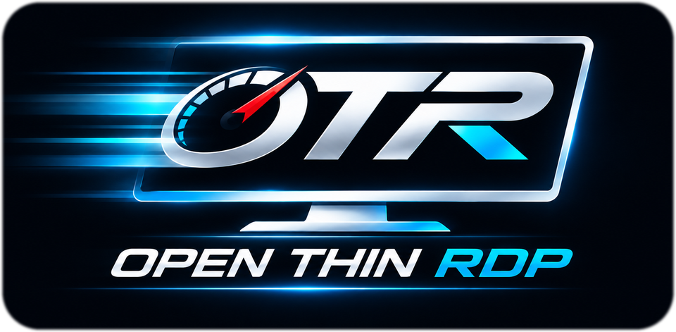

<b>Il primo thin client open source con RDP su UDP. 
Leggero, gratuito, fatto per Desktop remoto Windows: il desktop resta fluido anche quando la rete non lo è.</b>

<a href="https://github.com/OpenThinRdp/openthinrdp/releases/latest"><b>Scarica l'ultima versione</b></a>
&nbsp;·&nbsp; <a href="https://openthinrdp.github.io/?from=readme-it">Sito</a>
&nbsp;·&nbsp; <a href="https://openthinrdp.github.io/manager.html?from=readme-it">Il gestore</a>
&nbsp;·&nbsp; <a href="README.md">English</a>

Questa pagina riassume il progetto in italiano. La documentazione completa e aggiornata è in inglese: i link qui sotto
portano lì.

## OpenThinRDP: il thin client

OpenThinRDP è un sistema leggero che fa una cosa sola e la fa bene: si accende in pochi secondi sul modulo di accesso
e apre il tuo Windows a tutto schermo, il desktop o la VM dell'utente tramite un RD Connection Broker, un host di
sessione o qualsiasi PC con Desktop remoto, in sede o nel cloud.

- **RDP su UDP acceso dal primo avvio**: con metà dei pacchetti persi il desktop va ancora a 19-21 fotogrammi al
  secondo, dove il TCP è fermo. Le correzioni nate dai nostri test sono entrate in FreeRDP
  ([#13608](https://github.com/FreeRDP/FreeRDP/pull/13608)). [I numeri misurati](docs/udp.md).
- **Webcam fino a 1080p a 30 fps** in Teams e Zoom, con l'accelerazione hardware dove la postazione la offre; cuffie,
  chiavette di firma e strumenti USB come se fossero collegati a Windows.
- **Debian 13**, da 2 GB di RAM su qualsiasi PC o thin client a 64 bit, installato o live da una chiavetta USB. Hyper-V, Proxmox, VMware o cloud: va
  bene qualsiasi infrastruttura con Desktop remoto Windows.
- **Gestione da una cartella condivisa**: configurazione centrale, aggiornamenti firmati, logo, lo schermo di ogni
  postazione nel browser. Nessun agente, nessun server di gestione, nessuna licenza per postazione.
- **Configurazione automatica dal dominio** (zero-touch), VPN, 802.1X, RD Gateway.
- Licenza GPLv3. Alternativa gratuita a IGEL OS e Dell ThinOS: [il confronto](docs/alternatives.md).

Per iniziare: [Getting started](docs/guides/getting-started.md) · [Hardware provato](docs/hardware.md) ·
[FAQ](docs/faq.md) · [Novità di ogni versione](CHANGELOG.md).

## OpenThinRDP Manager: il gestore

Il gestore **non è uno script PowerShell per modificare i file .conf**: è un programma Windows gratuito, con
l'interfaccia in italiano e in inglese, che non si installa. Fa due cose in una finestra:

- **Centro salute dell'infrastruttura Windows**, anche senza nessun thin client OpenThinRDP: host e cluster di failover
  Hyper-V, Servizi Desktop remoto, controller di dominio e DNS, SQL Server AlwaysOn, backup delle VM, Dell iDRAC,
  Proxmox, vSphere, Veeam, Citrix e certificati. Trova cosa non va, lo dice in una frase e lo ripara quando confermi.
  Nessun agente, nessun server, nessun database.
- **Gestione della flotta OpenThinRDP**: stato di ogni postazione, impostazioni centrali, gruppi, aggiornamenti,
  sessioni e desktop, schermo remoto.

Si aggiorna da solo dalle release firmate. Pagina del gestore: [openthinrdp.github.io/manager.html](https://openthinrdp.github.io/manager.html?from=readme-it) ·
progetto: [OpenThinRdp/openthinrdp-manager](https://github.com/OpenThinRdp/openthinrdp-manager) ·
guida: [docs/manager.md](docs/manager.md) ·
[controllo di salute per Hyper-V e Desktop remoto](docs/guides/hyper-v-rds-health-check.md).

## Domande rapide

**OpenThinRDP è gratuito?** Sì: il sistema dei thin client è open source (GPLv3), il gestore è gratuito anche per uso
commerciale.

**Serve un server di gestione?** No: basta una cartella condivisa di Windows; il gestore lavora su quella.

**Il gestore funziona senza thin client OpenThinRDP?** Sì: il centro salute controlla Hyper-V, Desktop remoto, dominio,
SQL, backup e hardware anche da solo.

**Dove segnalo un problema?** Nelle [issue di GitHub](https://github.com/OpenThinRdp/openthinrdp/issues), in italiano o in
inglese.
