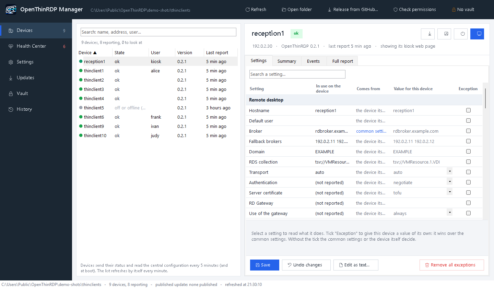
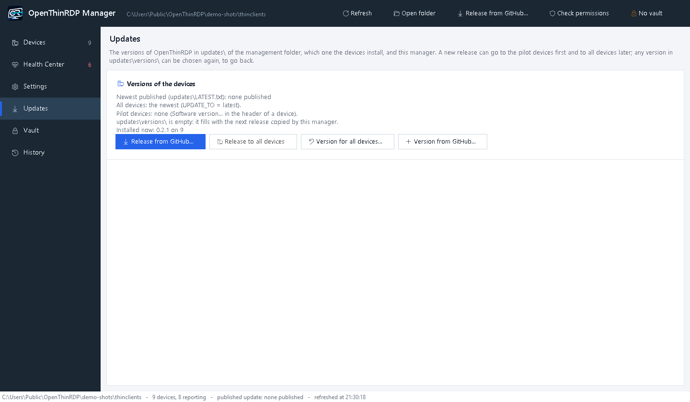

<p align="center"></p>

<p align="center"><b>Il sistema operativo per thin client open source con l'RDP su UDP<br>
per Desktop remoto Windows, RDS e VDI: FreeRDP con il trasporto UDP che la versione ufficiale non ha ancora.</b></p>

<p align="center">
<a href="https://github.com/OpenThinRdp/openthinrdp/releases/latest"><b>⬇ Scarica la ISO (ultima versione)</b></a>
&nbsp;·&nbsp; <a href="#provarlo-in-cinque-minuti">Provalo in live, senza installare niente</a>
&nbsp;·&nbsp; <a href="https://openthinrdp.github.io/it/">Sito</a>
&nbsp;·&nbsp; <a href="README.md">English</a>
</p>

<p align="center">


</p>

OpenThinRDP trasforma piccoli PC e vecchi thin client in postazioni che si accendono direttamente sul form di
accesso e si collegano a Windows: tramite il broker RDS al desktop o alla VM dell'utente, oppure direttamente a
un host di sessione o a qualsiasi PC Windows con Desktop remoto attivo, **in sede o nel cloud** (Azure, AWS,
qualsiasi fornitore). Si gestiscono da una cartella condivisa con un piccolo gestore Windows: stato di ogni
postazione, configurazione centrale, logo, aggiornamenti firmati, e lo schermo di qualsiasi postazione nel browser.
Niente agenti, niente server di gestione, nessun servizio cloud da cui dipendere, nessuna licenza per postazione.

> **Non è openthinclient.** OpenThinRDP è un progetto nuovo e indipendente, senza alcun legame con openthinclient: i
> nomi si somigliano, nient'altro è in comune. openthinclient è un progetto più vecchio in cui le postazioni si avviano
> da rete (PXE) dal suo server di gestione; OpenThinRDP si installa su ogni postazione o gira live da una chiavetta
> USB, non ha bisogno di un server ed è costruito attorno a RDP con il trasporto UDP di FreeRDP.

È nato da una migrazione reale da un sistema thin client commerciale, su un parco di Dell OptiPlex 3000 Thin
Client collegati a una VDI Windows 11 su Hyper-V, dove il sistema da cui deriva lavora ogni giorno.

> **Stato: in produzione ogni giorno.** Fa girare tutti i thin client dell'azienda da cui nasce: 14 Dell OptiPlex
> 3000 Thin Client in ufficio, alle casse, in laboratorio, alle pese e uno schermo a parete in Wi-Fi, con una
> VDI Windows 11 su Hyper-V dietro due RD Connection Broker, con accesso Kerberos e NTLM di riserva. Le postazioni
> sono state convertite sul posto dal sistema che avevano prima e ricevono ogni versione dalla loro cartella di
> gestione (il gestore controlla ogni release di GitHub e la firma di nuovo con la chiave del sito), installata
> durante le sessioni e applicata quando la sessione finisce. Gli aggiornamenti di sicurezza di FreeRDP arrivano in OpenThinRDP
> [entro 7 giorni](SECURITY.md#freerdp-security-fixes) (la 3.32.2: in quattro ore). La ISO è provata in QEMU/KVM
> con Secure Boot a ogni versione e i test di sistema girano a ogni commit
> ([CI](https://github.com/OpenThinRdp/openthinrdp/actions/workflows/tests.yml)). Cosa è in produzione, cosa è solo
> provato e cosa non c'è ancora: **[docs/status.md](docs/status.md)**. Provatela in live, poi su una postazione,
> prima di estenderla.

## RDP su UDP che regge anche su una linea pessima

Tutto è partito da una porta di switch guasta che perdeva il 43% dei pacchetti grandi: in TCP il desktop remoto
si bloccava. Abbiamo riprodotto quella linea e poi alzato la perdita su tutti i pacchetti della macchina virtuale
un gradino alla volta (VDI Windows 11, carico a schermo intero che cambia ogni pixel, fotogrammi misurati dal
server):

| pacchetti persi | in TCP | **OpenThinRDP in UDP** |
|---|---|---|
| 20% | 0,6 fotogrammi al secondo: lo schermo quasi non si muove | non misurato (19-21 fps al 50%) |
| 43% di quelli grandi\* (la porta guasta) | 0-0,1 fps | **16-21 fps**, 7 minuti di fila |
| 50% | non misurato (0,2 fps già al 30%) | **19-21 fps**, come su una linea pulita |
| 70% | non misurato | **18-19 fps**\*\* |
| 80% | non misurato | 4 fps, poi il tunnel si arrende |

\* Le altre righe perdono quella quota di tutti i pacchetti; questa il 43% dei pacchetti grandi e il 5% dei piccoli.
\*\* Al 70% la connessione TCP che RDP tiene accanto al tunnel può chiudere la sessione dopo 20 s senza conferme.
Un solo ambiente (Dell OptiPlex 3000 Thin Client, VDI Windows 11 su Hyper-V), perdita simulata con netem:
[metodo e script](tests/udp-bench/README.md) per avere i vostri numeri.

Per arrivarci è servita una correzione al trasporto UDP di FreeRDP, che abbiamo trovato e segnalato in
[#13608](https://github.com/FreeRDP/FreeRDP/pull/13608) e che ora ne fa parte. Tutti i gradini e i numeri del TCP:
[docs/udp.md](docs/udp.md#on-a-lossy-line).

## Per chi è

- Pubblicate desktop con **Servizi Desktop remoto di Windows**: broker RDS con host di sessione o raccolta VDI su
  Hyper-V. Oppure non c'è nessun broker: ogni postazione si collega a un PC o server Windows (al posto del broker
  si mette il suo nome), per esempio una reception che lavora sul PC dell'ufficio. Le postazioni fuori sede passano
  dall'**RD Gateway** in HTTPS ([`RDP_GATEWAY`](docs/configuration.md#rd-gateway)).
- I vostri desktop sono **nel cloud**: un deployment RDS o macchine virtuali Windows in Azure, AWS, Google Cloud o da
  qualsiasi fornitore, raggiunti tramite RD Gateway o VPN, con UDP attraverso la VPN
  ([dettagli](docs/configuration.md#desktops-in-the-cloud)). Azure Virtual Desktop e Windows 365 non sono ancora
  supportati (richiedono l'accesso con Microsoft Entra ID).
- Avete **PC o thin client x86-64, nuovi o vecchi**: UEFI con o senza Secure Boot, oppure BIOS tradizionale, con il
  kernel e i firmware Debian completi ([hardware](docs/hardware.md)), e volete tenerli in servizio senza una licenza
  per postazione.
- Volete **provare RDP in UDP** su client veri, o aiutarlo a entrare in FreeRDP.
- Vi servono **schermi che mostrano solo una pagina web**: TV nella hall, dashboard, punti informativi, tabelloni
  di produzione. Lo stesso sistema, senza accesso, con la pagina decisa centralmente
  ([vedi sotto](#schermi-che-mostrano-solo-una-pagina-web)): una sola immagine per tutto il parco macchine.

Non (ancora) per voi: Citrix, VMware/Omnissa Horizon e altri protocolli (OpenThinRDP fa solo RDP), dispositivi
ARM (il Raspberry Pi 4 è [in preparazione](https://github.com/OpenThinRdp/openthinrdp/issues/61)), PC solo a 32 bit.

## Requisiti

| | Minimo |
|---|---|
| Dispositivo | qualsiasi PC o thin client x86 a 64 bit, **UEFI** (Secure Boot supportato, non obbligatorio) **o BIOS tradizionale**: vanno bene anche i vecchi PC d’ufficio e i thin client usati |
| Driver | il kernel Debian 13 completo e tutti i pacchetti firmware di Debian: quello che fa girare Debian 13 fa girare OpenThinRDP |
| Memoria | 2 GB di RAM |
| Spazio | 8 GB per installarlo (eMMC, SSD o disco); nessuno per provarlo in live da una chiavetta |
| Rete | cavo, Wi-Fi (WPA2 personale) o un adattatore Ethernet USB |
| TPM 2.0 | facoltativo: se c'è, i segreti del dispositivo (password della cartella di gestione, chiave Wi-Fi, chiavi SSH) restano cifrati dentro il TPM ([sicurezza](docs/security.md)); senza, funziona uguale |
| Lato Windows | un broker RDS (host di sessione o raccolta VDI su Hyper-V), oppure qualsiasi PC o server Windows che accetti il Desktop remoto (Pro, Enterprise, Server), in sede o in qualsiasi cloud |

Hardware provato e impostazioni del firmware: [docs/hardware.md](docs/hardware.md).

## Provarlo in cinque minuti

1. [Scaricate `openthinrdp-<versione>.iso`](https://github.com/OpenThinRdp/openthinrdp/releases/latest) e scrivetela
   su una chiavetta con qualsiasi programma che scriva immagini (Rufus in modalità DD, balenaEtcher, `dd`).
2. Avviate il PC dalla chiavetta. Il menu fa partire da solo il **sistema live** dopo 10 secondi: gira dalla
   chiavetta e **non scrive mai sul disco**.
3. Con la rete, se su GitHub c'è una versione più nuova di quella della ISO chiede se scaricarla o usare quella
   della ISO (senza risposta in 30 secondi scarica la nuova): la ISO non serve riscaricarla a ogni versione. Poi si
   apre la configurazione: impostate il broker (o il nome di un PC Windows) e il dominio, salvate, accedete.
4. Vi piace? Riavviate e scegliete **Install**: mostra il disco che sta per cancellare e chiede conferma prima
   di scrivere qualsiasi cosa (confermate per proseguire), poi circa tre minuti. Installa sul **primo disco interno**, mai
   su un disco USB (nemmeno la chiavetta). Per le installazioni in serie, *Unattended install* salta la domanda.

Cosa serve al dispositivo: [Requisiti](#requisiti).

## Cosa fa

- **Desktop remoto in UDP.** Windows manda la grafica (e USB, audio e telecamera) in UDP e adatta fotogrammi e qualità alla linea invece di
  accumulare ritardo: più fluido con server carichi, Wi-Fi con perdite e VPN. L'immagine contiene FreeRDP
  compilato con il trasporto UDP ancora in revisione ([FreeRDP #13608](https://github.com/FreeRDP/FreeRDP/pull/13608)).
  Per postazione: `auto` (UDP, TCP se l'UDP è bloccato), `udp` (solo UDP) o `tcp`. Nella nostra prova di 3 ore con
  perdita di pacchetti, banda limitata, rete staccata e client uccisi la sessione è rimasta sempre in UDP
  ([risultati](https://github.com/FreeRDP/FreeRDP/pull/13608#issuecomment-6110587552)). Vedi [docs/udp.md](docs/udp.md).
- **Form di accesso, poi desktop remoto a schermo intero**, avvio in pochi secondi con il vostro logo, niente
  desktop, niente shell. Tentativi, broker di riserva, messaggi chiari per rete assente, broker irraggiungibile,
  macchina virtuale che non parte, password sbagliata (mai ritentata, così l'account non si blocca). Una macchina
  virtuale che si sta riavviando o sta installando un aggiornamento di Windows mostra "In attesa di Windows" (fino
  a 20 minuti) invece di un errore.
- **Si riconnette da solo** dopo le cadute di rete, si ferma quando la sessione viene chiusa apposta (disconnetti,
  esci, VM spenta dall'amministratore), e avvisa prima di prendersi una sessione aperta su un'altra postazione.
  Una sessione presa da un'altra postazione mostra "Sessione aperta altrove" con *Riprendi qui*.
- **USB pensato per la VDI**: chiavette di firma, chiavi tachigrafo e altri dispositivi particolari vanno a
  Windows interi, anche collegati a sessione aperta. **Webcam e cuffie funzionano in riunione**: la telecamera
  passa dal canale telecamera di RDP e il microfono dal canale audio, così Teams, Zoom e il browser della sessione
  li vedono entrambi (un microfono passato come dispositivo USB resta fuori dalla sessione remota). Tastiere,
  mouse, touch, hub e schede di rete restano locali; i lettori di smart card passano dal canale smart card.
  I touch screen funzionano come touch in Windows. Con `USB_MODE=disks` le chiavette USB restano sul thin client e
  compaiono in Windows come unità; con `USB_MODE=auto` il thin client decide dispositivo per dispositivo: una
  chiavetta come unità, un dispositivo con memoria e altro (uno strumento, una chiave col suo driver) intero.
- **Gestione da una cartella condivisa (SMB) con un gestore Windows**, senza server: tutto il parco in una finestra,
  impostazioni per tutte le postazioni o per una, e lo **schermo remoto** di qualsiasi postazione
  ([il gestore](#il-gestore-tutto-il-parco-in-una-finestra)).
- **Aggiornamenti firmati** che non interrompono mai una sessione: dalle release di GitHub (controllate ogni 3
  ore, installati in background, applicati quando la sessione finisce), o dalla vostra cartella quando decidete voi.
  **Una versione si prova prima su poche postazioni**, e si **torna indietro** a una precedente se qualcosa non va
  ([`UPDATE_TO`](docs/configuration.md#management)): FreeRDP torna indietro con lei. Gli aggiornamenti di sicurezza Debian si installano da soli.
- **Configurazione sulla postazione** (anche protetta da PIN): broker o PC, rete (DHCP, statica, Wi-Fi), cartella
  di gestione e il suo account, modalità USB, pulsante web, orari, lingua. Una postazione nuova prende il nome
  dalla propria scheda di rete (`thinclient-1a2b3c`).
- **Diagnostica per l'assistenza**, senza PIN (il pulsante ℹ): rete, raggiungibilità di ogni broker o PC, ora,
  cartella di gestione, ultimi eventi. Solo lettura.
- **Blindata**: niente desktop, niente menu, niente console di testo (Ctrl+Alt+F1..F12 non fanno nulla), nessun
  account senza password.
- **Più monitor** diventano un unico desktop remoto su tutti (`MULTIMON`).
- **Orari di accensione e spegnimento e Wake-on-LAN**, schermo sempre acceso, monitor accesi in ritardo gestiti.
- **Pulsante web**: un'applicazione web, navigazione libera o una pagina kiosk a schermo intero, con Chromium
  ([schermi che mostrano solo una pagina web](#schermi-che-mostrano-solo-una-pagina-web)).
- Interfaccia in italiano e inglese; altre lingue sono un file ciascuna.

<p align="center">


</p>

## Il gestore: tutto il parco in una finestra

`OpenThinRDP-Manager` è un unico script PowerShell per Windows 10/11 (in italiano e in inglese, niente da installare)
che lavora sulla cartella condivisa dove le postazioni scrivono il loro stato. Niente server, niente agenti, niente
database: quello che vedete sono i file della cartella.

<p align="center">


</p>

- **Ogni postazione a colpo d'occhio**: stato, utente, versione, ultimo rapporto, un riepilogo leggibile e il
  registro degli eventi di ciascuna.
- **Impostazioni per tutte le postazioni o per una**, controllate prima di salvare, con il valore in uso su ogni
  postazione e quello ancora in arrivo.
- **Una versione nuova prima su poche postazioni, poi su tutte**: *Release da GitHub* chiede *solo le postazioni
  pilota* o *tutte*; le altre restano dove sono fino a *Rilascia a tutte*.
- **Ritorno a una versione precedente se qualcosa non va**, per tutto il parco o per una postazione, FreeRDP
  compreso: un clic nella pagina Aggiornamenti.
- **Schermo remoto** di qualsiasi postazione nel browser, solo via SSH, con un avviso sulla postazione.
- **Problemi di tutto il parco** raggruppati da tutti i registri; una **cassaforte** per la chiave SSH e la chiave di
  firma; il parco sulla **sua chiave di firma**; logo e sfondo; e il gestore **si aggiorna da solo** dalle release
  firmate.

**Tutto quello che fa, pagina per pagina, con i passi per un gruppo pilota e per tornare indietro (in inglese):
[docs/manager.md](docs/manager.md).**

## Schermi che mostrano solo una pagina web

La stessa immagine fa funzionare gli schermi che non hanno mai bisogno di un desktop Windows: una TV nella hall,
una dashboard in ufficio, un punto informativo, un tabellone in produzione. Con `WEB_BUTTON=kiosk` e `KIOSK_URL`:

- All'accensione la pagina si apre **a schermo intero in Chromium**: nessun accesso, nessun desktop, nessun menu,
  nessuna barra degli indirizzi.
- La pagina si decide **centralmente**, per tutti gli schermi (`config\common.conf`), per un gruppo o per uno solo
  (`config\<hostname>.conf`) nella cartella di gestione. Cambiandola, ogni schermo la prende entro pochi minuti e
  riapre la pagina, senza riavvio.
- **Si ricarica da sola** ogni `KIOSK_RELOAD_MIN` minuti quando nessuno la sta toccando, così una pagina finita in
  errore dopo un problema di rete torna da sola.
- L'**orario di accensione** accende e spegne gli schermi (`POWER_ON_TIME`, `POWER_OFF_TIME`, `POWER_ON_DAYS`), via
  cavo o Wi-Fi; stato ed eventi di ogni schermo sono nella cartella di gestione come per ogni altro dispositivo.
- Cookie e accessi salvati restano anche dopo i riavvii. Per le dashboard con login, un link con gettone di accesso
  (lo offre la maggior parte degli strumenti per dashboard) evita del tutto di accedere dallo schermo.
- Chi è davanti allo schermo può comunque arrivare al modulo di accesso: compare per 5 secondi prima della pagina,
  e Ctrl+Shift+W chiude la pagina. Le impostazioni si possono bloccare con un PIN.

Impostazioni: [docs/configuration.md](docs/configuration.md#web-button-and-kiosk-page).

## Perché è fatto così

**Perché FreeRDP non si aggiorna da solo.** Gli aggiornamenti di sicurezza di Debian si installano da soli, ma
FreeRDP è escluso. Primo, l'immagine contiene un FreeRDP compilato con l'UDP, che i pacchetti Debian
sostituirebbero con una versione senza. Secondo, il client di desktop remoto è la parte da cui dipendono gli
utenti: una versione nuova può cambiare il comportamento di sessioni, dispositivi USB, smart card o grafica, e su un
parco di postazioni un difetto ferma tutti nello stesso momento. Per questo FreeRDP arriva con le release di
OpenThinRDP, dopo la prova su postazioni vere, e si può comunque bloccare su una singola postazione
(`/etc/openthinrdp/freerdp-pinned`).

**Perché l'UDP da una pull request non ancora unita.** In TCP un server carico o una linea con perdite fanno
restare indietro lo schermo; in UDP Windows abbassa invece la qualità. Nelle nostre prove la pull request è solida,
e l'unico modo perché venga unita è che qualcuno la usi e segnali. `TRANSPORT=tcp` è a un'impostazione di
distanza, e l'immagine segue il codice di FreeRDP mentre cambia.

**Perché una cartella condivisa e non un server di gestione.** Ogni rete Windows ha già una condivisione e
qualcuno che ne gestisce i permessi. Le postazioni leggono e scrivono solo file lì: niente da installare,
aggiornare o licenziare lato server, e le impostazioni sono file di testo che si leggono, si confrontano e si
salvano.

**Perché Debian.** Stabile, aggiornamenti di sicurezza per anni, tutti i driver e i firmware, e sopra un kiosk
che si può leggere: tutta la parte client sono pochi script in `rootfs/opt/openthinrdp`.

## Confronto

| | **OpenThinRDP** | Dell ThinOS | IGEL OS | Stratodesk NoTouch | ThinStation |
|---|---|---|---|---|---|
| Costo | gratuito | incluso nei thin client Dell | abbonamento per postazione | licenza per postazione | gratuito |
| Sorgente | aperto (Apache 2.0) | chiuso | chiuso | chiuso | aperto |
| Gira su | PC e thin client x86-64, UEFI o BIOS | thin client Dell | molti dispositivi x86-64 | PC x86-64, Raspberry Pi | PC x86 |
| Protocolli | solo RDP | Citrix, Omnissa/VMware, Microsoft e altri | Citrix, Omnissa/VMware, Microsoft e altri | molti | molti (immagine da costruire) |
| Gestione | cartella condivisa + strumento Windows, nessun server | Wyse Management Suite | server UMS | NoTouch Center | file di configurazione su un server di rete |
| Aggiornamenti | firmati, da GitHub o dalla vostra cartella | firmware del produttore | del produttore | del produttore | si ricostruisce l'immagine |
| Installazione | ISO, live o installazione automatica | preinstallato | installatore o preinstallato | installatore | si costruisce, poi PXE o USB |

Se servono Citrix o Horizon, il supporto di un produttore o hardware certificato, i sistemi commerciali sono la
scelta giusta. OpenThinRDP è per le reti basate su Desktop remoto Windows che vogliono un client libero, gratuito
e semplice da gestire, e per chi vuole mettere al lavoro il trasporto UDP di FreeRDP. I nomi dei prodotti sono
marchi dei rispettivi proprietari; il confronto riflette informazioni pubbliche e la nostra comprensione,
correzioni benvenute.

## I prossimi passi

Le idee che vorremmo realizzare, più o meno in quest'ordine. Diteci in una issue quali vi servono, o mandate una
pull request:

- **VPN**: WireGuard e OpenVPN, così una postazione a casa o in una sede distaccata raggiunge il broker da sola.
- **RD Gateway**: Desktop remoto in HTTPS da fuori rete, senza VPN.
- **Wi-Fi con 802.1X** (WPA-Enterprise) e 802.1X sulla rete cablata.
- **Installazione da rete (PXE)** per molte postazioni insieme.
- **Altro hardware provato** e altre lingue (un file ciascuna).

## Costruire la propria immagine

Con il vostro logo, broker, impostazioni e chiavi già dentro (Linux con Docker o Podman):

```
cp -r image/site.example image/site      # poi modificare site.conf, build.conf, aggiungere il logo
image/build.sh                           # -> out/openthinrdp-<versione>.iso
```

Vedi [docs/building.md](docs/building.md).

## Documentazione

La documentazione è in inglese nella cartella [docs](docs/).

- [CHANGELOG.md](CHANGELOG.md): le novità di ogni versione.
- [docs/status.md](docs/status.md): cosa è in produzione, cosa è solo provato, cosa non c'è ancora.
- [docs/configuration.md](docs/configuration.md): tutte le impostazioni.
- [docs/manager.md](docs/manager.md): il gestore Windows pagina per pagina: postazioni, impostazioni, postazioni pilota e ritorno indietro (in inglese).
- [docs/management.md](docs/management.md): la cartella di gestione, la configurazione centrale, le chiavi SSH, gli
  aggiornamenti firmati.
- [docs/building.md](docs/building.md): costruire e personalizzare l'immagine.
- [docs/security.md](docs/security.md): modello di sicurezza e limiti noti.
- [docs/hardware.md](docs/hardware.md): hardware provato e impostazioni del firmware.
- [docs/udp.md](docs/udp.md): il trasporto UDP e il FreeRDP contenuto nell'immagine.

## Struttura

| Cartella | Contenuto |
|---|---|
| `rootfs/` | tutto quello che si installa sul thin client (`/opt/openthinrdp`, regole udev, unità systemd) |
| `image/` | la costruzione della ISO (live-build in un container), la compilazione di FreeRDP e la cartella del sito di esempio |
| `management/windows/` | il gestore Windows (PowerShell, nessuna installazione) |
| `management/publish/` | costruzione e firma dei pacchetti di aggiornamento |
| `tests/` | test che girano in un container Debian |

## Contribuire

Issue e pull request sono benvenute, anche in italiano. Per tutto ciò che riguarda connessioni o dispositivi,
descrivete l'hardware e il lato Windows (broker, versione dell'host di sessione). I problemi di sicurezza vanno segnalati in privato,
vedi [SECURITY.md](SECURITY.md). Come contribuire: [CONTRIBUTING.md](CONTRIBUTING.md); regole di convivenza:
[CODE_OF_CONDUCT.md](CODE_OF_CONDUCT.md).

## Licenza

Apache License 2.0, vedi [LICENSE](LICENSE). OpenThinRDP usa FreeRDP (Apache 2.0), il visore noVNC dello schermo remoto
(incluso senza modifiche, MPL 2.0 e BSD, [rootfs/opt/openthinrdp/novnc](rootfs/opt/openthinrdp/novnc)) e pacchetti Debian con le loro
licenze. Windows e Desktop remoto sono marchi di Microsoft; il progetto non è affiliato a Microsoft né ai
produttori citati.
