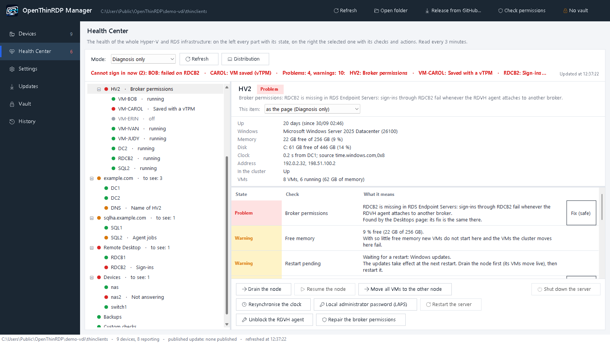
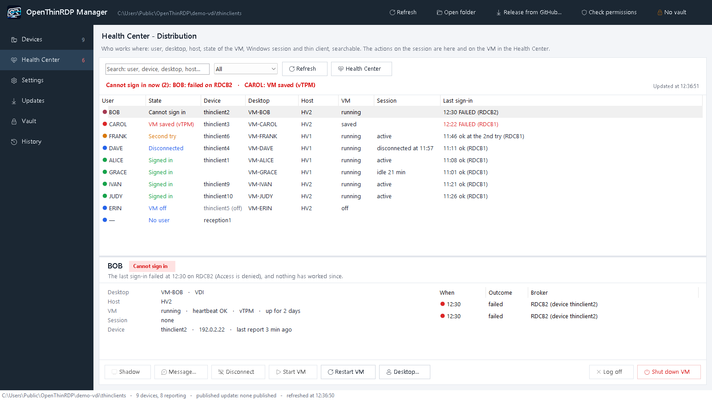

<p align="center"></p>

<p align="center"><b>The free thin client OS for Windows Remote Desktop, RDS and VDI, on Hyper-V, Proxmox, VMware or any cloud.<br>
RDP over UDP that keeps working where TCP freezes, and a whole fleet managed from one Windows window.</b></p>

<p align="center">
<a href="https://github.com/OpenThinRdp/openthinrdp/releases/latest"><b>⬇ Download the ISO (latest release)</b></a>
&nbsp;·&nbsp; <a href="#try-it-in-five-minutes">Try it live, nothing installed</a>
&nbsp;·&nbsp; <a href="https://openthinrdp.github.io/">Website</a>
&nbsp;·&nbsp; <a href="README.it.md">Italiano</a>
</p>

<p align="center">


</p>

**Turn any PC or old thin client into a locked-down Remote Desktop kiosk in five minutes.** It boots straight into
a sign-in form and connects to Windows: through an RD Connection Broker to the user's desktop or VM, or straight to
a session host or any Windows PC, **on premises or in the cloud**. No licence per device, no management server, no
agent, no cloud service to depend on: a shared folder and the free [OpenThinRDP Manager](https://openthinrdp.github.io/manager.html) for Windows are all it takes.

| | |
|---|---|
| **Any hypervisor, any cloud** | Windows desktops and VMs on **Hyper-V, Proxmox VE, VMware vSphere/ESXi, Nutanix AHV, XCP-ng, KVM**, Azure, AWS or Google Cloud, physical PCs, and Linux desktops through xrdp: RDP is spoken by the machine you connect to, so what runs underneath does not matter ([Proxmox and VMware](docs/guides/proxmox-vmware-thin-client.md)) |
| **Smooth on bad lines** | RDP over UDP: on a line losing half of the packets the desktop still runs at 19-21 frames per second, where TCP has already frozen ([numbers below](#rdp-over-udp-that-keeps-going-on-a-bad-line)) |
| **Zero-touch setup** | a new device needs a domain account and nothing else: it finds its management folder in the domain by itself ([how](docs/manager.md#settings--manager-language-and-local-copy)) |
| **The whole fleet in one window** | state of every device, central settings, signed updates with pilot devices and rollback, power on (Wake-on-LAN), restart, remote screen |
| **The Windows side too** | Health Center: brokers, Hyper-V hosts and cluster, VMs, DCs, DNS, SQL AlwaysOn and backups, with a plain sentence and a fix for each problem |
| **Any x86-64 hardware** | UEFI with Secure Boot or legacy BIOS, complete Debian 13 kernel and firmware, from 2 GB of RAM |
| **Free** | the client is GPLv3, every copy stays open source (Debian underneath, every client script readable in `rootfs/opt/openthinrdp`); the [Windows manager](https://github.com/OpenThinRdp/openthinrdp-manager) is free for any use, closed, with every command it runs on your servers readable |

> **In production every day.** OpenThinRDP runs the whole thin client fleet of the company it was built for:
> 14 Dell OptiPlex 3000 Thin Clients at desks, tills, a laboratory, weighing stations and a wall screen on Wi-Fi,
> on a Windows 11 VDI on Hyper-V behind two RD Connection Brokers. Every release reaches them through their
> management folder and installs while people work, applied when the session is over. FreeRDP security releases
> reach OpenThinRDP [within 7 days](SECURITY.md#freerdp-security-fixes); the ISO is tested in QEMU/KVM with Secure
> Boot at every release and the system tests run on every commit
> ([CI](https://github.com/OpenThinRdp/openthinrdp/actions/workflows/tests.yml)). What is in production, what is only
> tested and what does not exist yet: **[docs/status.md](docs/status.md)**.

> **Not openthinclient.** OpenThinRDP is a new, independent project, not affiliated with openthinclient: the names
> sound alike, nothing else is shared. openthinclient boots its devices over the network (PXE) from its management
> server; OpenThinRDP is installed on each device or runs live from a USB stick, needs no server and is built around
> RDP with FreeRDP's UDP transport.

## RDP over UDP that keeps going on a bad line

Over TCP, every lost packet stops the screen until it is sent again: a lossy Wi-Fi, a VPN or a faulty cable is
enough to freeze the remote desktop. Over UDP, Windows drops what is late and lowers the quality instead, and the
desktop keeps moving. Measured on a Windows 11 VDI with a full-screen load changing every pixel, frame rate counted
by the server, loss applied to every packet from the virtual machine:

| packets lost | over TCP | **OpenThinRDP over UDP** |
|---|---|---|
| 0% | | **15-21 fps** |
| 5% | 7-12 fps | |
| 10% | 6 fps | |
| 20% | 0.6 fps: the screen barely moves | |
| 30% | 0.2 fps: frozen | |
| 50% | | **19-21 fps**, as on a clean line |
| 60% | | **14-21 fps** |
| 70% | | **18-19 fps** |
| 80% | | 4 fps, then the tunnel gives up |

Empty cells were not measured: TCP was already frozen at 30%, and UDP at 50% ran as on a clean line. One
environment (Dell OptiPlex 3000 Thin Client, Windows 11 VDI on Hyper-V), loss emulated with netem:
[the method and the scripts](tests/udp-bench/README.md) to get your own numbers, and every step in
[docs/udp.md](docs/udp.md#on-a-lossy-line).

The UDP transport comes from our work in FreeRDP: we found and fixed what made it fail on lossy lines, and it was
merged upstream as [#13608](https://github.com/FreeRDP/FreeRDP/pull/13608). Upstream ships it switched off;
OpenThinRDP has it on, with `TRANSPORT=tcp` one setting away.

## Who it is for

- You publish desktops with **Windows Remote Desktop Services**: RD Connection Broker with session hosts or a
  Hyper-V VDI collection. Or there is no broker at all: each device connects to one Windows PC, server or VM (set
  its name instead of the broker), e.g. a reception desk that works on the PC in the office. Devices outside the
  office go through the **RD Gateway** over HTTPS ([`RDP_GATEWAY`](docs/configuration.md#rd-gateway)) or their own
  **VPN**, WireGuard or OpenVPN ([`VPN`](docs/configuration.md#vpn)).
- Your VMs run on **Proxmox VE, VMware vSphere/ESXi, Nutanix AHV, XCP-ng or KVM**: each device opens its own
  Windows VM, or an RDS farm whose session hosts run there; Linux desktops through xrdp. And the
  [manager](https://openthinrdp.github.io/manager.html) watches Proxmox and vSphere too
  ([Proxmox and VMware](docs/guides/proxmox-vmware-thin-client.md)).
- Your desktops are **in the cloud**: an RDS deployment or Windows virtual machines in Azure, AWS, Google Cloud
  or with any provider, reached through the RD Gateway or a VPN, with UDP through a VPN
  ([details](docs/configuration.md#desktops-in-the-cloud)). Azure Virtual Desktop and Windows 365 are not supported
  yet (they need a Microsoft Entra ID sign-in).
- You have **x86-64 PCs or thin clients, new or old**: UEFI with or without Secure Boot, or a legacy BIOS, with the
  complete Debian kernel and firmware ([hardware](docs/hardware.md)), and want to keep them useful without a licence
  per device.
- You want to **try RDP over UDP** on real clients, or help bring it into FreeRDP.
- You need **screens that only show a web page**: hall TVs, dashboards, info points, production boards. The same
  system, no sign-in, the page chosen centrally ([see below](#screens-that-only-show-a-web-page)), so one image
  covers the whole fleet.

**Next on the roadmap:** native Proxmox sessions over SPICE (the VM chosen in Proxmox itself, Linux VMs included)
and VNC. Running Citrix or Omnissa Horizon and want them here too?
[Tell us](https://github.com/OpenThinRdp/openthinrdp/issues): what users ask for comes first. 32-bit only PCs are
not supported. ARM is experimental: an SD card image for the Raspberry Pi 4
([pre-release](https://github.com/OpenThinRdp/openthinrdp/releases/tag/rpi-test-1)), tested in QEMU emulation only,
not yet on a real board ([what to check](docs/arm.md)); the Pi 5 is not supported yet.

## Requirements

| | Minimum |
|---|---|
| Device | any 64-bit x86 PC or thin client, **UEFI** (Secure Boot supported, not required) **or legacy BIOS**: old office PCs and used thin clients are fine |
| Drivers | the complete Debian 13 kernel and every Debian firmware package: what runs Debian 13 runs OpenThinRDP |
| Memory | 2 GB of RAM |
| Storage | 8 GB to install it (eMMC, SSD or disk); nothing to try it live from a USB stick |
| Network | cable, Wi-Fi or a USB Ethernet adapter; WPA2/WPA3 personal or Enterprise, and 802.1X on the cable |
| TPM 2.0 | optional: with one, the device's secrets (management folder password, Wi-Fi key, SSH host keys) are kept encrypted in it ([security](docs/security.md)); without one it works the same |
| Windows side | an RD Connection Broker (RDS session hosts or a Hyper-V VDI collection), or any Windows PC, server or VM that accepts Remote Desktop (Pro, Enterprise, Server), on any hypervisor (Hyper-V, Proxmox, VMware, Nutanix, XCP-ng, KVM), on premises or in any cloud; Linux desktops through xrdp |

Tested hardware and firmware settings: [docs/hardware.md](docs/hardware.md).

## Try it in five minutes

1. [Download `openthinrdp-<version>.iso`](https://github.com/OpenThinRdp/openthinrdp/releases/latest) and write it
   to a USB stick with any raw image writer (Rufus in DD mode, balenaEtcher, `dd`).
2. Boot the PC from the stick. The menu starts the **live system** by itself after 10 seconds: it runs from the
   stick and **never writes to the disk**.
3. With a network, when GitHub has a newer version than the ISO it asks whether to download it or to use the
   ISO's (no answer in 30 seconds: the newer one), so the ISO does not need downloading again for every release.
   Then the settings dialog opens: set the broker (or the name of a Windows PC) and the domain, save, sign in.
4. Like it? Restart and choose **Install**: it shows the disk it is going to erase and asks before writing
   anything (answer *Yes* to go on), then about three minutes. It installs on the **first internal disk**, never
   a USB disk (not even the installation stick). For rollouts, *Unattended install* skips the question.

What the device needs: [Requirements](#requirements). The whole path, from the USB stick to a managed fleet:
[getting started](docs/guides/getting-started.md).

## What it does

- **Remote desktop over UDP.** Windows sends the graphics (and USB, sound and camera) over UDP and adapts frame rate and quality to the line
  instead of queueing: smoother on busy servers, lossy Wi-Fi and VPNs. The image ships FreeRDP with the UDP
  transport switched on ([FreeRDP #13608](https://github.com/FreeRDP/FreeRDP/pull/13608), merged upstream, off there by default).
  Per device: `auto` (UDP, TCP when UDP is blocked), `udp` (UDP only) or `tcp`. In our 3-hour test with packet
  loss, bandwidth limits, network cuts and killed clients the session stayed on UDP the whole time
  ([results](https://github.com/FreeRDP/FreeRDP/pull/13608#issuecomment-6110587552)). See [docs/udp.md](docs/udp.md).
- **Sign-in form, then full screen remote desktop.** Boots in a few seconds with your logo, no desktop, no
  shell. Retries, fallback brokers, clear messages for "no network", "broker not reachable", "the virtual
  machine does not start", wrong password (never retried, so accounts are not locked). A virtual machine that is
  restarting or installing a Windows update gets "Waiting for Windows" (up to 20 minutes) instead of an error.
- **Reconnects by itself** after network drops, stops when the session is ended on purpose (sign out,
  disconnect, VM shut down by an administrator), and warns before taking over a session open on another device.
  A session taken over by another device shows "Session opened elsewhere" with *Resume here*.
- **USB done right for VDI.** Signature keys, tachograph keys and other special devices go to Windows as whole
  USB devices, also when plugged in during the session. **Webcams and headsets work in meetings**: the camera goes
  through the RDP camera channel and the microphone through the RDP audio channel, so Teams, Zoom and the browser
  in the session see both (a microphone passed as a USB device stays outside the remote session). Keyboards, mice,
  touch screens, hubs and network adapters stay local; smart card readers go through the smart card channel.
  Touch screens work as touch in Windows. With `USB_MODE=disks` USB sticks stay on the thin client and appear in
  Windows as drives; with `USB_MODE=auto` the thin client decides device by device: a stick as a drive, a device
  with storage and something else (an instrument, a key with its own driver) whole.
- **Managed from a shared folder (SMB) with a Windows manager**, no server: the whole fleet in one window, settings
  for all devices or one, and the **remote screen** of any device ([the manager](#the-manager-the-whole-fleet-from-one-window)).
- **Signed updates** that never interrupt a session: from GitHub releases (checked every 3 hours, installed in
  the background, applied when the session is over), or from your folder when you decide.
  **Try a version on a few devices first**, and **go back** to an earlier one when something breaks
  ([`UPDATE_TO`](docs/configuration.md#management)): FreeRDP goes back with it.
  Debian security updates install by themselves.
- **Settings dialog on the device** (optionally behind a PIN): broker or PC, network (DHCP, static, Wi-Fi),
  management folder and its account, USB mode, web button, power schedule, language. A new device names itself
  from its network card (`thinclient-1a2b3c`).
- **Hardware test**: started by itself on the live system and from Diagnostics on any device, it checks processor,
  memory, disk, graphics driver, missing firmware, network, sound, USB, TPM, Secure Boot and the remote desktop, and
  can open a ready-made hardware report on GitHub (no name, address or serial number in it).
- **Diagnostics for the help desk**, no PIN needed (the ℹ button): network, can each broker or PC be reached,
  time, management folder, last events. Read only.
- **Locked down**: no desktop, no menus, no text consoles (Ctrl+Alt+F1..F12 do nothing), no password-less
  account.
- **Several monitors** become one remote desktop spanning all of them (`MULTIMON`).
- **Power schedule and Wake-on-LAN**, screen always on, monitors switched on late handled.
- **Web button**: a web app, free browsing, or a full screen kiosk page, with Chromium
  ([screens that only show a web page](#screens-that-only-show-a-web-page)).
- English, Italian and Dutch interface; more languages are one file each.

<p align="center">


</p>

## The manager: the fleet and the servers behind it, from one window

The [OpenThinRDP Manager](https://github.com/OpenThinRdp/openthinrdp-manager) is a free program for Windows 10/11 and
Windows Server (English and Italian, nothing to install) that works on the shared folder the devices report to. No
server, no agent, no database: what you see is the files in the folder. It also works alone, without devices, as a
health center for Hyper-V, clusters, Remote Desktop, SQL and backups. It is not a script that edits configuration files: it is a Windows application with [releases of its own](https://github.com/OpenThinRdp/openthinrdp-manager/releases) (1.0.0 from 28 October 2026) that updates itself, signed with the project key ([its page](https://openthinrdp.github.io/manager.html)).

<p align="center">




</p>

- **Every device at a glance**: state, user, version, last report, a readable summary and the event log of each.
- **Power and commands**: power on with Wake-on-LAN, restart, switch off, send its status now, run a command and see
  its output.
- **Zero-touch from the domain**: *Name it in the domain* and a new device needs only a domain account; *Move the
  folder* moves the whole fleet to a new share in one step; *Check permissions* gives the devices' account exactly
  the rights it needs.
- **The configuration as text** too: `common.conf` and each device's file, checked like the pages before saving.
- **Settings for all devices or one**, checked before saving, with the value in use on each device and what is
  still on its way.
- **A new version on a few devices first, then on all**: *Release from GitHub* asks *pilot devices only* or *all
  devices*; the others stay where they are until *Release to all devices*.
- **Back to an earlier version when something breaks**, for the whole fleet or one device, FreeRDP included: one
  click on the Updates page.
- **Remote screen** of any device in your browser, over SSH only, with a notice on the device.
- **The Windows side of the desktops** (Remote Desktop Services with Hyper-V): who cannot sign in now and why, each
  user with the device, the desktop, its host, the session and the last sign-in; brokers and hosts checked (a broker
  that fails every request, a missing permission, a stuck RDVH agent), each problem with its fix; actions on VMs and
  sessions, always confirmed and logged.
- **Health Center: the health of the whole Hyper-V and RDS infrastructure from the manager**: hosts, failover cluster,
  storage, VMs, domain controllers, DNS, SQL AlwaysOn, the NAS and the witness, the backups, in one tree with a state
  for each item and a plain sentence for each problem; *diagnosis only* or *diagnosis and repair*, where only safe
  repairs run by themselves.
- **The history of the fleet**, problems grouped from every event log; a **vault** for the SSH key and the signing key; your
  fleet on **its own signing key**; logo and background; and the manager **updates itself** from the signed releases.

**Everything it does, page by page, with the steps for a pilot group and for going back: [docs/manager.md](docs/manager.md).**

## Screens that only show a web page

The same image runs the screens that never need a Windows desktop: a TV in the hall, a dashboard in the
office, an info point, a board in production. With `WEB_BUTTON=kiosk` and `KIOSK_URL`:

- At power on the page opens **full screen in Chromium**: no sign-in, no desktop, no menus, no address bar.
- The page is set **centrally**, for every screen (`config\common.conf`), a group or a single one
  (`config\<hostname>.conf`) in the management folder. Change it and each screen picks it up within a few
  minutes and reopens the page, without a restart.
- It **reloads itself** every `KIOSK_RELOAD_MIN` minutes when nobody is touching it, so a page that went to an
  error after a network glitch comes back by itself.
- The **power schedule** switches the screens on and off (`POWER_ON_TIME`, `POWER_OFF_TIME`, `POWER_ON_DAYS`),
  on cable or Wi-Fi; status and events of every screen are in the management folder like any other device.
- Cookies and saved sign-ins stay across restarts. For dashboards behind a login, a link with an access token
  (offered by most dashboard tools) avoids signing in on the screen at all.
- Someone at the screen can still reach the sign-in form: it shows for 5 seconds before the page, and
  Ctrl+Shift+W closes the page. The settings can be locked with a PIN.

Settings: [docs/configuration.md](docs/configuration.md#web-button-and-kiosk-page).

## Why it is built this way

**Why FreeRDP is not updated automatically.** Debian security updates install by themselves, but FreeRDP is
excluded. First, the image ships its own FreeRDP build with UDP, which Debian's packages would replace with a
version without it. Second, the remote desktop client is the part users depend on: a new FreeRDP version can
change how sessions, USB devices, smart cards or the graphics behave, and on a fleet a regression stops everyone
at the same moment. So FreeRDP comes with OpenThinRDP releases, after testing on real devices, and you can still
keep it as it is on one device (`/etc/openthinrdp/freerdp-pinned`).

**Why UDP on by default.** Over TCP, a busy server or a lossy line makes the screen fall behind; over UDP, Windows
lowers quality instead. The transport is now part of FreeRDP ([#13608](https://github.com/FreeRDP/FreeRDP/pull/13608),
merged after weeks of tests on our fleet), switched off there by default; OpenThinRDP switches it on, and
`TRANSPORT=tcp` is one setting away.

**Why a shared folder instead of a management server.** Every Windows network already has a file share and
someone who can manage permissions on it. The devices only read and write files there, so there is nothing to
install, patch or license on the server side, and the settings are plain text files you can read, diff and back
up.

**Why Debian.** Stable, security updates for years, every driver and firmware package, and a kiosk on top of it
that you can read: the whole client side is a few shell scripts in `rootfs/opt/openthinrdp`.

## How it compares

| | **OpenThinRDP** | Dell ThinOS | IGEL OS | Stratodesk NoTouch | ThinStation |
|---|---|---|---|---|---|
| Cost | free | comes with Dell thin clients | subscription per device | licence per device | free |
| Source | client open (GPLv3), manager free but closed | closed | closed | closed | open |
| Runs on | x86-64 PCs and thin clients, UEFI or BIOS; Raspberry Pi 4 (experimental) | Dell thin clients | many x86-64 devices | x86-64 PCs, Raspberry Pi | x86 PCs |
| Protocols | RDP to Windows on any hypervisor or cloud, and xrdp; SPICE and VNC next | Citrix, Omnissa/VMware, Microsoft and more | Citrix, Omnissa/VMware, Microsoft and more | many | many (you build the image) |
| Management | shared folder + Windows tool, no server | Wyse Management Suite | UMS server | NoTouch Center | configuration files on a network server |
| Updates | signed, from GitHub or your folder | vendor firmware | vendor | vendor | rebuild the image |
| Install | ISO, live or automatic installation | preinstalled | installer or preinstalled | installer | build, then PXE or USB |

OpenThinRDP is for networks built on Windows Remote Desktop, on whatever hypervisor or cloud, that want a free, open
client that is simple to manage, and for anyone who wants to put FreeRDP's UDP transport to work. Need Citrix or
Horizon today, vendor support or certified hardware? The commercial systems do that; tell us what would make you
switch. Product names are trademarks of
their owners; the comparison reflects public information and our understanding, corrections are welcome.

Each of them in more detail, and **Linux Mint or Ubuntu with Remmina**: [docs/alternatives.md](docs/alternatives.md).
Questions people ask first (hardware, drivers, UDP, Azure, PXE, 802.1X): [docs/faq.md](docs/faq.md).

## What comes next

Ideas we would like to build, roughly in this order. Tell us in an issue which ones you need, or send a pull
request:

- **Network installation (PXE)** for many devices at once.
- **More tested hardware** and more languages (one file each).
- **Programs on demand**: the browser to use (Firefox ESR, Brave, Google Chrome, Microsoft Edge, or the Chromium of
  the image), and other programs or Debian packages, installed only on the devices that choose them and kept up to
  date; the web button could also start one of them. We will build it as soon as a second user asks for it.

## Build your own image

Your logo, your broker, your settings and keys built in (Linux with Docker or Podman):

```
cp -r image/site.example image/site      # then edit image/site/site.conf and build.conf, add your logo
image/build.sh
```

The result is `out/openthinrdp-<version>.iso`. See [docs/building.md](docs/building.md).

## Documentation

- [CHANGELOG.md](CHANGELOG.md): what changed in each release.
- [docs/status.md](docs/status.md): what is in production, what is only tested, what does not exist yet; [docs/maturity.md](docs/maturity.md): production readiness area by area, with the evidence.
- [docs/known-issues.md](docs/known-issues.md): what does not work as it should yet, and what to do meanwhile.
- [MAINTAINERS.md](MAINTAINERS.md) and the [release checklist](docs/release-checklist.md): who maintains it, how a release is made.
- [docs/configuration.md](docs/configuration.md): every setting.
- [docs/guides/getting-started.md](docs/guides/getting-started.md): step by step, from a USB stick to a managed fleet.
- [docs/faq.md](docs/faq.md): frequently asked questions.
- Guides: [replacing Dell ThinOS on Dell thin clients](docs/guides/replace-dell-thinos.md), [turning an old PC into a thin client](docs/guides/old-pc-thin-client.md).
- [docs/alternatives.md](docs/alternatives.md): compared with Linux Mint + Remmina, IGEL OS, Dell ThinOS, Stratodesk, ThinStation, openthinclient.
- [docs/manager.md](docs/manager.md): the Windows manager, page by page: devices, settings, pilot devices and going back.
- [docs/management.md](docs/management.md): the management folder, central settings, SSH keys, signed updates.
- [docs/building.md](docs/building.md): building and customizing the image.
- [docs/security.md](docs/security.md): security model and known limits.
- [docs/privacy.md](docs/privacy.md): the anonymous counts the project receives, all of them, and how to switch them off.
- [docs/hardware.md](docs/hardware.md): tested hardware and firmware settings.
- [docs/udp.md](docs/udp.md): the UDP transport and the FreeRDP the image ships.
- [docs/guides/hyper-v-rds-health-check.md](docs/guides/hyper-v-rds-health-check.md): the manager alone, a free health check for Hyper-V clusters and Remote Desktop, without an agent.

## Layout

| Folder | Content |
|---|---|
| `rootfs/` | everything installed on the thin client (`/opt/openthinrdp`, udev rules, systemd units) |
| `image/` | the ISO build (live-build in a container), the FreeRDP build and the example site folder |
| [openthinrdp-manager](https://github.com/OpenThinRdp/openthinrdp-manager) | the Windows manager, a separate project: its releases, issues and license |
| `management/publish/` | building and signing update packages |
| `tests/` | tests that run in a Debian container |

## Contributing

Issues and pull requests are welcome. Please describe the hardware and the Windows side (broker, session
host version) for anything related to connections or devices. See [CONTRIBUTING.md](CONTRIBUTING.md) and the
[code of conduct](CODE_OF_CONDUCT.md).

Security problems: please report them privately, see [SECURITY.md](SECURITY.md).

## License

The thin client: GNU General Public License version 3 or later, see [LICENSE](LICENSE) and [NOTICE](NOTICE): anyone may use, study, change and share it, and every copy or modified version that is distributed must stay under the same licence, with its source.
The manager for Windows: from 0.2.23 a separate project, [openthinrdp-manager](https://github.com/OpenThinRdp/openthinrdp-manager), free for any use but closed ([its license](https://github.com/OpenThinRdp/openthinrdp-manager/blob/main/LICENSE.md)); the commands it runs on your servers stay readable. The manager of the releases up to and including 0.2.22 was published under the GNU GPL version 3 or later and stays under it.
screen (included unmodified, MPL 2.0 and BSD, [rootfs/opt/openthinrdp/novnc](rootfs/opt/openthinrdp/novnc)) and Debian packages under
their own licenses. Windows and Remote Desktop are trademarks of Microsoft; this project is not affiliated with
Microsoft or with any vendor named above.
