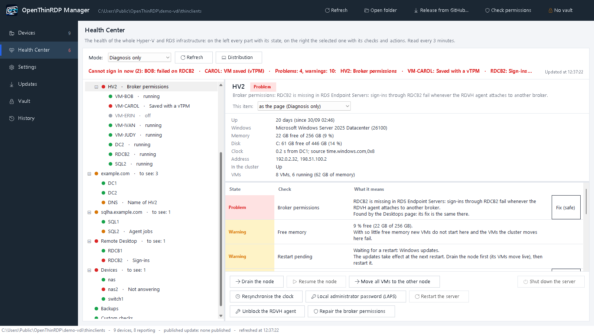
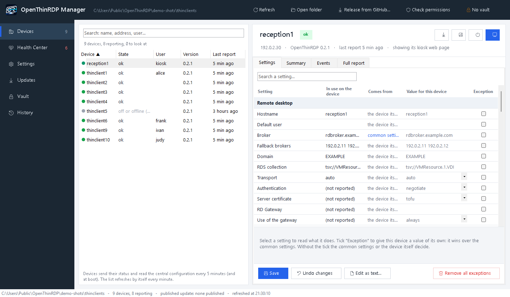

<b>The free thin client OS for Windows Remote Desktop: one PC at home, or a whole office on a domain. 
Reuse the PCs and thin clients you have. No licence, no server, no account.</b>

<a href="https://github.com/OpenThinRdp/openthinrdp/releases/latest"><b>⬇ Download the ISO</b></a>
&nbsp;·&nbsp; <a href="#try-it-in-five-minutes">Try it live, nothing installed</a>
&nbsp;·&nbsp; <a href="https://openthinrdp.github.io/">Website</a>
&nbsp;·&nbsp; <a href="docs/faq.md">FAQ</a>
&nbsp;·&nbsp; <a href="README.it.md">Italiano</a>

**OpenThinRDP turns a PC, an old laptop or a used thin client into a Remote Desktop terminal in five minutes.** It
starts straight into a sign-in form and opens your Windows desktop in full screen; programs and data stay on the
Windows side. The first start asks one question:

- **At home, or one computer** (*Workgroup*): your Windows PC or virtual machine, found on the network, signed in by
  itself at power on and woken up if it is off; from anywhere with Tailscale. Try it from a USB stick that keeps your
  settings, or install it next to Windows. **[OpenThinRDP at home](docs/guides/home.md)**
- **In the office, on a domain**: RD Connection Brokers, session collections and VDI, devices that set themselves up
  from the domain, a whole fleet managed from a shared folder. **[For companies](docs/guides/business.md)** · **[Getting started](docs/guides/getting-started.md)**

## Why OpenThinRDP

| | |
|---|---|
| **Reuse what you have** | any 64-bit PC or thin client from 2 GB of RAM: old office PCs, laptops that cannot run Windows 11, a used Dell Wyse 5070, HP t630 or Fujitsu Futro ([which ones](docs/guides/used-thin-client.md)). Complete Debian 13 drivers |
| **Smooth on bad lines** | RDP over UDP built in: on a line losing half of its packets the desktop still runs at 19-21 frames per second, where TCP has frozen ([the numbers](docs/features.md#rdp-over-udp-that-keeps-going-on-a-bad-line)) |
| **Secure and locked down** | no desktop, no terminal, signed updates, secrets in the TPM, Kerberos, 802.1X, RD Gateway and VPN ([security](docs/security.md)) |
| **Managed from one place** | settings, signed updates with pilot devices and a way back, remote screen, zero-touch from the domain: from a shared folder, no management server ([the manager](docs/manager.md)) |
| **Everything Windows needs** | USB keys and special devices, webcams and headsets in Teams and Zoom, smart cards, several monitors, touch screens |
| **Any hypervisor, any cloud** | Hyper-V, Proxmox VE, VMware vSphere, Nutanix AHV, XCP-ng, KVM, Azure, AWS, a physical PC; Linux desktops through xrdp ([Proxmox and VMware](docs/guides/proxmox-vmware-thin-client.md)) |
| **Free** | no cost per device, no subscription, no account: the client is open source (GPLv3), the [Windows manager](https://github.com/OpenThinRdp/openthinrdp-manager) free for any use |

> **In production every day.** OpenThinRDP runs the whole thin client fleet of the company it was built for:
> 14 Dell OptiPlex 3000 Thin Clients at desks, tills, a laboratory, weighing stations and a wall screen on Wi-Fi,
> on a Windows 11 VDI on Hyper-V behind two RD Connection Brokers. Every release reaches them and installs while
> people work. FreeRDP security releases reach OpenThinRDP [within 7 days](SECURITY.md#freerdp-security-fixes); the
> system tests run on every commit ([CI](https://github.com/OpenThinRdp/openthinrdp/actions/workflows/tests.yml)).
> What is in production, what is only tested and what does not exist yet: **[docs/status.md](docs/status.md)**.

## Try it in five minutes

1. [Download the ISO](https://github.com/OpenThinRdp/openthinrdp/releases/latest) and write it to a USB stick (Rufus
   in DD mode, balenaEtcher, `dd`).
2. Start the PC from the stick. The **live system** runs from the stick and **never writes to the disk**; with a
   network it offers the newest version, so the ISO does not need downloading again for every release.
3. Choose *Workgroup* or *Domain*, set your Windows PC or your broker, and sign in.
4. Like it? Restart and choose **Install** (it shows the disk it will erase and asks first), or *Install alongside
   Windows* on a laptop that keeps Windows. For rollouts, *Unattended install* skips the question.

| You need | |
|---|---|
| The device | any 64-bit x86 PC or thin client, UEFI (Secure Boot or not) or legacy BIOS, 2 GB of RAM, 8 GB of storage (none to run it live). TPM 2.0 optional ([hardware](docs/hardware.md)) |
| The Windows side | an RD Connection Broker (RDS session hosts or VDI), or any Windows PC, server or VM with Remote Desktop on (Pro, Enterprise, Education, Server: not Home) |

## The manager: the servers and the fleet, from one window

The [OpenThinRDP Manager](https://openthinrdp.github.io/manager.html) is a free Windows application (nothing to
install, English and Italian). Its first part is a **Health Center for the infrastructure behind the desktops**,
useful also without any OpenThinRDP device: Hyper-V hosts and clusters, Storage Spaces Direct, RD Connection Brokers,
VMs, domain controllers, DNS, SQL Server Always On, backups, Dell iDRAC, Proxmox, vSphere, Veeam, Citrix and
certificates, with a plain sentence and a repair you confirm for each problem. Its second part **manages the
devices**: state of each one, central settings, signed updates on pilot devices first and a way back, Wake-on-LAN,
remote screen. No server, no agent, no database. A single computer at home does not need it.

Page by page: [docs/manager.md](docs/manager.md). Its releases: [openthinrdp-manager](https://github.com/OpenThinRdp/openthinrdp-manager/releases).

## How it compares

| | **OpenThinRDP** | Dell ThinOS | IGEL OS | Stratodesk NoTouch | ThinStation |
|---|---|---|---|---|---|
| Cost | free | comes with Dell thin clients | subscription per device | licence per device | free |
| Source | client open (GPLv3), manager free but closed | closed | closed | closed | open |
| Runs on | x86-64 PCs and thin clients, UEFI or BIOS; Raspberry Pi 4 (experimental) | Dell thin clients | many x86-64 devices | x86-64 PCs, Raspberry Pi | x86 PCs |
| Protocols | RDP to Windows on any hypervisor or cloud, and xrdp; SPICE and VNC next | Citrix, Omnissa/VMware, Microsoft and more | Citrix, Omnissa/VMware, Microsoft and more | many | many (you build the image) |
| Management | shared folder + Windows tool, no server | Wyse Management Suite | UMS server | NoTouch Center | configuration files on a network server |
| Home use | yes: workgroup, Wake-on-LAN, Tailscale | business only | business only | business only | possible, by hand |

Need Citrix or Horizon today, vendor support or certified hardware? The commercial systems do that;
[tell us](https://github.com/OpenThinRdp/openthinrdp/issues) what would make you switch. The comparison reflects
public information and our understanding; product names are trademarks of their owners. In detail, with Linux Mint
or Ubuntu with Remmina: [the alternatives](docs/alternatives.md).

> **Not openthinclient.** OpenThinRDP is a new, independent project, not affiliated with openthinclient: the names
> sound alike, nothing else is shared.

## Guides

**At home and for one PC**
- [OpenThinRDP at home](docs/guides/home.md): an old laptop as a terminal for your Windows PC
- [Windows 10 end of support](docs/guides/windows-10-end-of-support.md): old PCs as terminals for an up-to-date Windows
- [Remote Desktop from Linux](docs/guides/linux-rdp-client.md): FreeRDP, Remmina or a thin client OS; slow RDP; Windows Home
- [Raspberry Pi as a thin client](docs/guides/raspberry-pi-thin-client.md) (experimental)

**In the office**
- [OpenThinRDP for companies](docs/guides/business.md): RDS and VDI, zero-touch, updates you control, security, costs
- [Getting started](docs/guides/getting-started.md): from a USB stick to a managed fleet
- [Which OS for a used thin client](docs/guides/used-thin-client.md): Wyse 5070, HP t630, t640, Futro S740
- [Turning an old PC into a thin client](docs/guides/old-pc-thin-client.md)
- [Replacing Dell ThinOS](docs/guides/replace-dell-thinos.md)
- [Proxmox, VMware and Nutanix](docs/guides/proxmox-vmware-thin-client.md)
- [A free health check for Hyper-V and Remote Desktop](docs/guides/hyper-v-rds-health-check.md): the manager alone

**Reference**
- [Every feature in detail](docs/features.md), [every setting](docs/configuration.md), [RDP over UDP](docs/udp.md),
  [hardware](docs/hardware.md), [FAQ](docs/faq.md)
- [The manager](docs/manager.md), [the management folder and signed updates](docs/management.md),
  [building your own image](docs/building.md)
- [Security](docs/security.md), [privacy](docs/privacy.md), [status](docs/status.md), [production readiness](docs/maturity.md),
  [known issues](docs/known-issues.md), [changelog](CHANGELOG.md)

## What comes next

Network installation (PXE) for many devices at once, native Proxmox sessions over SPICE and VNC, more tested hardware
and more languages. Running Citrix or Omnissa Horizon, or a model we have not tested?
[Tell us](https://github.com/OpenThinRdp/openthinrdp/issues): what users ask for comes first.

## Contributing

The most useful contribution is simple: run it on your hardware and tell us what happened, in the
[discussions](https://github.com/OpenThinRdp/openthinrdp/discussions) or an issue. Code, translations and how the
repository is laid out: [CONTRIBUTING.md](CONTRIBUTING.md). Security problems: privately, see [SECURITY.md](SECURITY.md).

## License

The thin client: GNU General Public License version 3 or later, see [LICENSE](LICENSE) and [NOTICE](NOTICE): anyone
may use, study, change and share it, and every copy or modified version that is distributed must stay under the same
licence, with its source. The manager for Windows: from 0.2.23 a separate project,
[openthinrdp-manager](https://github.com/OpenThinRdp/openthinrdp-manager), free for any use but closed
([its license](https://github.com/OpenThinRdp/openthinrdp-manager/blob/main/LICENSE.md)); the commands it runs on your
servers stay readable. Included software under other licences: FreeRDP (Apache 2.0), the noVNC viewer for the remote
screen (unmodified, MPL 2.0 and BSD) and the Debian packages, each under its own licence. Windows and Remote Desktop
are trademarks of Microsoft; this project is not affiliated with Microsoft or with any vendor named above.
