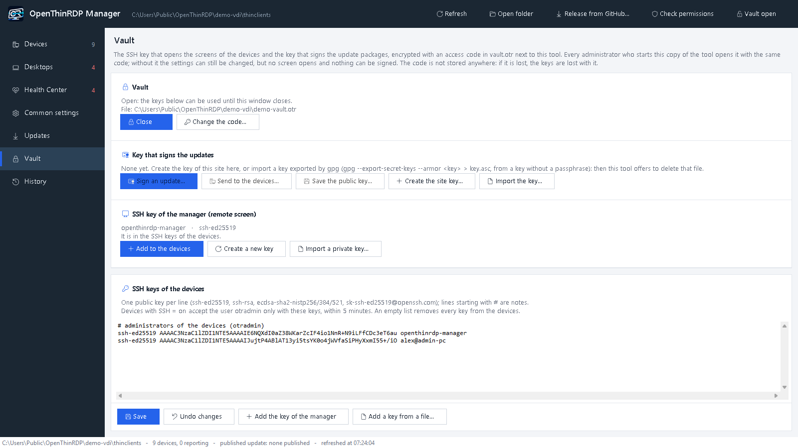

# Management folder

One SMB share (a folder on any Windows or Samba file server) is the whole management system. Every device
mounts it every 5 minutes, at boot and at every new event, writes its status and reads settings and updates.

```
\\fileserver\thinclients\
  status\<hostname>.txt        status: KEY=value lines + last errors and events
  status\<hostname>-events.log event log
  status\SUMMARY.csv           one line per device (rewritten by the devices)
  config\common.conf           settings for every device
  config\<hostname>.conf       settings for one device (wins over common.conf)
  config\groups\<group>\_group.conf      settings for a group of devices (between common.conf and each device)
  config\groups\<group>\<hostname>.conf  the file of a device of that group: the folder it is in IS its group;
                               moving it to another group folder (manager: Group..., or by hand) moves the device
  config\authorized_keys       SSH public keys of the administrators (optional)
  config\branding\logo.png, splash.png              logo and background picture for every device (optional)
  config\branding\<hostname>\logo.png, splash.png   for one device (wins over the common ones)
  config\backup\, changes.log  written by the Windows manager
  updates\LATEST.txt(.sig)     signed update index of the newest version, and the packages
  updates\versions\<version>.txt(.sig)   the index of every version that can be chosen (UPDATE_TO)
```

## Account

The devices log in with `/etc/openthinrdp/smb.cred` (root only). Two ways to get it there:

- **On the device**, also with the downloadable ISO: in the settings dialog, *Management folder user*
  (`user`, `DOMAIN\user` or `user@domain`; without a domain, `DOMAIN` is used) and *Management folder
  password*. The user is a normal setting (`MGMT_USER`); the password goes only into `smb.cred`, is never shown
  again, never in the status files, and an empty field keeps the saved one. Central settings can change both
  (`MGMT_USER=`, `MGMT_PASSWORD=` in `config\common.conf` or `config\<hostname>.conf`), e.g. to rotate it.
- **In your own image**: `image/site/smb.cred`:

  ```
  username=svc-thinclients
  password=...
  domain=EXAMPLE
  ```

Every device can read this password, so use an account that can do as little as possible: not a member of
Domain Users, no rights outside this folder, and inside it **write access to `status\` only**. A device only
writes its status and events there; settings, branding and updates it only reads. So a stolen device gives
its holder an account that can fill `status\` with nonsense, but cannot change the settings of the other
devices or put anything in `updates\`.

| folder | devices' account | administrators |
|---|---|---|
| the management folder itself | Read (to list and open the subfolders) | Full control |
| `status\` | Modify | Full control |
| `config\` (with `branding\`) | Read | Full control |
| `updates\` | Read | Full control |

With PowerShell on the file server (example account `EXAMPLE\svc-thinclients`, folder `D:\thinclients`):

```powershell
icacls D:\thinclients /grant "EXAMPLE\svc-thinclients:(OI)(CI)RX"
icacls D:\thinclients\status /grant "EXAMPLE\svc-thinclients:(OI)(CI)M"
```

The icacls lines only add rights: whatever the folder inherits stays, and a group such as Users or Domain
Users with write access inherited from above still lets the devices, or every user, change the settings.
**Check permissions** in the Windows manager reads the permissions of the folder for the account the devices
report (`MGMT_ACCOUNT` in their status, from 0.1.6; older devices: it asks for the account) and lists:

- whether the devices can write in `status\`;
- every place outside `status\` they can change (the folder itself, `config\` and its files, logos,
  `updates\`), and through which account or group;
- every place outside `status\` that Everyone, Authenticated Users, Users or Domain Users can change.

It follows the order of the rules as Windows does (the first rule that allows or denies a right decides it),
and the groups of the account in the domain, nested ones included. It reads the NTFS permissions only: the
permissions of the share can only take rights away. Check also from a device that the account cannot list
anything outside the folder.

## Central settings

Besides the settings, the folder holds what the managers share: `config\jobs.conf` (the scheduled jobs, read and run
by the devices: [manager.md](manager.md#scheduled-jobs)), `config\changes.log` (every change made from a manager),
and in `health\` the history of the infrastructure, the experience of the users (`experience\`, 40 days), the
required peripherals, the inventory and the group rules. The devices read none of `health\`; only the managers do.

`config\common.conf` and `config\<hostname>.conf` hold the same keys as [configuration.md](configuration.md).
Files saved on Windows are fine (BOM, CRLF, spaces around `=`, `#` and `;` comments). A device:

- merges common, then its own file, over its current settings;
- validates the result with the same rules as the settings dialog, and applies it only if something changed;
- refuses the whole result if anything is invalid (event "central configuration REJECTED", reported once),
  keeping the previous settings;
- keeps the last good copy when the folder is unreachable;
- does not apply them while a software update is installing (since 0.1.7): the next run does.

Central values win: a key in the central files is written into the device settings at every run (every 5
minutes and at boot), so a change made in the settings dialog of a device lasts only until then. Keys that the
central files do not set stay as set on the device.

Removing a key from the central files gives it back to the device defaults: the device drops it from its
settings and follows `site.conf` or the project defaults again, like a device installed today. If the result
would not be valid (e.g. removing `WEB_URL` while `WEB_BUTTON=app` stays), the key is kept, the event is logged
once and the release is retried at every run.

The [Windows manager](https://github.com/OpenThinRdp/openthinrdp-manager) (`OpenThinRDP-Manager.exe`, in the zip of every release) shows the devices, their status and events,
and edits these files with the same validation, a backup of every file it overwrites and a change log.
Before saving `common.conf` it lists the devices that would reject it.

The window has its pages on the left: **Devices** (the list, and the selected device with its settings, a summary,
its events and its full report), **Health Center** (with the **Distribution** of the desktops), **Settings** (devices, Health Center, manager, custom checks), **Updates** (see [Pilot devices and going back](#pilot-devices-and-going-back)
and [The manager updates itself](#the-manager-updates-itself)), **Vault** (with the SSH keys of the devices) and **History**; the actions on the
folder are on their pages (refresh on **Devices**, a release from GitHub on **Updates**, open the folder and check its permissions in **Settings > Manager**), and **Lock** is in the bar at the top. In a settings list each row shows
the value in use on the device, where it comes from (*the device itself*, *common settings*, *this device* for an
exception) and *on its way* when a saved value has not reached the device yet (it reads the folder every 5 minutes;
if it stays, the device has probably rejected the configuration: see its state). The help of the selected setting is
under the list; the search box finds a setting by name, key or help text.
It is available in English and Italian: it follows the Windows display language (English for any language
without a file in `lang\` of the manager), or `-Language en` / `-Language it` chooses one.

The window opens at 85% of the screen (at least 1440×880, maximized on a smaller screen) and works down to 860×560:
the columns of every list and grid share the width instead of hiding behind a scroll bar, the rows of buttons wrap,
and the buttons of the top bar and of the device header keep only their icon (their text in the tooltip) when the
room is short.

**Starting it.** `OpenThinRDP-Manager.exe` starts the manager with no console window, and draws the access window at
once while the manager loads behind it (what is typed goes to the manager through a pipe, never a file or the command
line). It is not signed with a certificate: Windows SmartScreen or an antivirus that holds back unknown programs may
ask the first time. Its arguments can live next to it, in `<name>.args` (one line, e.g.
`-Folder "\\fileserver\thinclients" -Language en`), so a shortcut needs none.

With the manager on a file share, a shortcut to the `.exe` on the share shows a blank icon: Windows reads the icon
of a shortcut's program only from a local disk. On each PC that starts the manager, run once from the share:

```
\\fileserver\it\manager\OpenThinRDP-Manager.exe -Install -Name "Thin clients" -Folder \\fileserver\thinclients
```

It copies the `.exe` to `%ProgramData%\OpenThinRDP` with a `.script` file that points to the manager on the share
(one copy of the manager for everybody), and puts a shortcut with the icon on the desktop. The manager keeps those
copies up to date by itself. The `.cmd` and `.vbs` of the releases before 0.2.23 go to `previous\`.

### Diagnostics of a device

One file with what is needed to understand a problem: the events, the log of the last session (kept also when the
device was switched off) and of the frozen ones, the status, the journal of this start and of the one before, the
kernel, the update logs, the network, the hardware, and the settings **without their secrets** (passwords, Wi-Fi
keys, PIN and private keys are removed; the credential, Wi-Fi and 802.1X files and the keys are never taken). User
and server names stay in it.

- **From the manager**: the power menu of a device, *Collect its diagnostics*. The device answers at its next report
  (within 5 minutes; at once when SSH is on and the vault open) and the file lands in `diag\` of the management
  folder. *Open its diagnostics* shows the newest one in Explorer and, if you want, opens a new issue on GitHub with
  the version filled in: you look at the file and attach it there yourself.
- **From the device**: the diagnostics screen (ℹ), *Send to the administrator*. Without a management folder the file
  stays on the device, in `/var/lib/openthinrdp/diag`.
- **By itself**: when the kiosk ends a frozen session, or the device is switched off with a session open, it
  collects them (at most once an hour) and sends them to `diag\` at the next report. The header of the device in the
  manager shows when there are some.

Nothing goes to the project unless you send it.

### The manager updates itself

Since 1.0.0 the manager has releases of its own on [its repository](https://github.com/OpenThinRdp/openthinrdp-manager/releases),
numbered apart from the devices (up to 0.2.27 it came with each release of the devices, with their number). Each one
carries `openthinrdp-manager-<version>.zip`: the manager (`OpenThinRDP-Manager.exe`, the manager itself sealed in
`OpenThinRDP-Manager.core`, the commands it runs on servers in `commands\` and `rds\`, its languages), `VERSION` and
`MANIFEST.txt`, the SHA-256 of each file signed with the project key, which the launcher checks before the manager
starts. Its name and SHA-256 are in the `LATEST.txt` of that release (`version=`, `manager=`, `manager_sha256=`),
signed with the project key.

- At every start the manager reads `VERSION` next to it, and in the background (the window does not wait) the
  `LATEST.txt` of the latest release of the manager, checked against the project key next to it
  (`openthinrdp-release.asc`). When it is a newer manager, the top bar shows *Manager X available*. The latest release
  of the devices (`UPDATE_GITHUB`) is read apart, for **Release from GitHub**.
- **By itself** (on by default; **Updates > This manager**, *Update the manager by itself*): the check runs at the
  start and every 6 hours, and a newer manager goes in at once with the steps below, when nothing is being edited
  and no other window is open (otherwise it tries again every 10 minutes). It starts again on the same folder with
  the vault still open: the access code passes to the new start in a file protected with DPAPI (this Windows user
  on this PC only), read once and deleted at once, worth 60 seconds.
- **Update the manager** (that notice, or **Updates > This manager**) downloads the zip, checks its hash against the
  signed `LATEST.txt`, checks that it holds the manager and `VERSION` of that version, copies the files
  it replaces into `previous\` next to the manager (the copy of the update before goes), puts the new ones in place
  and starts the manager again. `vault.otr`, the launchers (`.exe`, `.args`, `.script`) and anything else that is not
  in the zip stay as they are. A file in use is renamed to `.old` and removed at the next start. If anything fails,
  the files of `previous\` go back.
- The copy that matters is the one the administrators start: on a file share, update it from a PC that can write
  there (the manager says so when it cannot). PCs with a launcher made by `-Install` start the share copy, so they get
  the new version at their next start. A newer launcher in the release takes the place of the older ones (next to the
  manager and in `%ProgramData%\OpenThinRDP`) at the next start of the manager on that PC.
- Without the window, from a console or a script: `OpenThinRDP-Manager.exe -UpdateManager` (exit code 0 =
  updated, 1 = error, 2 = nothing to do).
- A copy without `VERSION` is a development copy and never updates itself.

The manager keeps the SSH host keys of the devices by device **name** in its own file
(`%LOCALAPPDATA%\OpenThinRDP\known_hosts`, `HostKeyAlias`), not by address: DHCP may give a device the address
another device had. A device that presents another key under its name (reinstalled) is reported, and the remote
screen asks whether to forget the old key.

## Logo and background picture

`logo.png` is the logo of the dialogs and of the sign-in form; `splash.png` is the background picture, shown
behind the sign-in form on the `BG_TOP`/`BG_BOTTOM` gradient. In `config\branding\` they are for every device,
in `config\branding\<hostname>\` for that device only; a device without them uses the ones of its image.
The manager's **Logo and background...** button (common settings, or a device) takes any picture, scales it
down and saves it as PNG there; files copied by hand are fine too.

<p align="center"></p>

The boot screen never changes from here: it always shows the picture and colors of the image (OpenThinRDP's,
or your own when you build your image with `image/site/splash.png`). At power on the device shows the boot
screen, then the background of your site from the sign-in form on.

A device accepts PNG files only, up to 2 MB, a logo up to 400 x 240 pixels and a background up to 1024 x 640
(anything else is refused once with an event, and the previous picture stays), and shows them within 5
minutes. The status file says where each picture comes from: `BRANDING=logo=common splash=image` (`image`,
`common` or `device`).

## Problems across the fleet

Every device sends its event log to `status\<hostname>-events.log`. The **History** page of the Windows manager
(since 0.1.7) reads them all together for a period (today, 24 hours, 7 or 30 days) and groups what went wrong:
sign-in attempts that failed (by the broker really contacted), desktops that did not start, sign-ins refused, sessions dropped (by
cause: network lost, FreeRDP stuck, error code), sessions taken over, UDP blocked, failed updates, rejected settings.
A dropped session's event ends with FreeRDP's last error, and the device keeps its FreeRDP log as
`/tmp/kiosk.log.prev`. Each line of the tab says how many times, on which devices and for which users, first
and last time; a line is orange when the same problem hit 3 or more devices, which points at a server or the network rather than at a device. The line at
the top sums up the problems that touched most devices; selecting a line shows its events. A device keeps the last
2000 lines of its log, which is weeks for a normal device.

## SSH keys

With `SSH=on`, the `otradmin` account accepts only the keys in `/etc/openthinrdp/authorized_keys`: from the image
(`image/site/authorized_keys`) or from `config\authorized_keys`. Removing `config\authorized_keys` after it
was used revokes those keys and brings back the image ones.

## Vault

Two keys give power over the whole fleet: the SSH key that opens the screen of any device, and the OpenPGP key
that signs the update packages every device installs. The manager keeps both in `vault.otr`, next to
`OpenThinRDP-Manager.ps1`, encrypted with an **access code**:

- At the first start the manager asks for the code (at least 8 characters) and creates the vault, with a new SSH
  key inside (`openthinrdp-manager`) that it adds to the **SSH keys of the devices** on the Vault page: Save there,
  and the devices take it within 5 minutes. At every later start it asks the code **before anything else** (no folder,
  no device, no window behind it): **Exit** ends the manager, a wrong code can be typed again (after three, each try
  waits longer), and the right one keeps the vault open for the session.
- Every administrator who starts the same copy of the manager (e.g. from a file share only the administrators can
  write) opens the same vault with the same code: nothing to copy from PC to PC. **Change the code...** re-encrypts
  it, and the old code stops working at once.
- The code is not stored anywhere. Keep it where you keep the other passwords of your servers: if it is lost, the
  keys are lost with it (a new SSH key is easy; a lost signing key means a key change, see
  [SECURITY.md](../SECURITY.md)).
- Encryption: PBKDF2-HMAC-SHA256 with 600000 rounds (about 2 seconds to open, on purpose), AES-256-CBC and
  HMAC-SHA256 over the whole file. The secrets stay in memory while the window
  is open; the SSH key is written for `ssh.exe` only into a folder that just your account and SYSTEM can read
  (`%LOCALAPPDATA%\OpenThinRDP\vault-keys`), removed when the vault closes.



On the **Vault** page:

| Block | Actions |
|---|---|
| Vault | Open / Close, Change the code |
| SSH key of the manager | Add to the devices (to the SSH keys of the devices below, then Save), Create a new key, Import a private key (e.g. the one used so far: the file stays where it is, delete it yourself) |
| Key that signs the updates | Sign an update (see [Signed updates](#signed-updates)), Send to the devices and Create the site key (see [A fleet on its own key](#a-fleet-on-its-own-key)), Save the public key (`update-key.asc`), Import the key: the file of `gpg --export-secret-keys --armor <key>` from a key without a passphrase; the manager offers to delete that file afterwards. |
| SSH keys of the devices | The public keys `otradmin` accepts (`config\authorized_keys`, one per line, # for notes): Save, Undo changes, Add the key of the manager, Add a key from a file |

The page says whether the signing key is the project key (releases for every installation) or one of yours
(`update-key.asc` of your image).

## Remote screen

**Remote screen...**, in the header of the selected device, shows its screen in your browser and lets you use it:
to see what a user sees, or to sign in once to a web page on a screen with no keyboard (the kiosk page keeps the
sign-in in its profile).

**What it needs**
- On the device: `SSH=on`, the key of the manager among the SSH keys, and `REMOTE_SCREEN=on` (the default). On
  the Vault page, under **SSH keys of the devices**, **Add the key of the manager** adds it (from the [vault](#vault)); then Save, and the
  devices take it within 5 minutes.
- On your PC: the OpenSSH client of Windows 10/11 (`ssh.exe`, an optional feature that is usually there), the
  vault open with the access code, and a browser. Nothing else is installed. Only the key of the vault is offered
  to the device (`ssh -i ... -o IdentitiesOnly=yes`): keys in your profile (`%USERPROFILE%\.ssh`) are not used.

**How it works**
1. Over SSH, as `otradmin`, the manager asks the device to start the remote screen (`remote-screen.sh start`). The
   device starts x11vnc on its screen and the noVNC viewer with a small WebSocket bridge (`vncbridge.py`), both on
   127.0.0.1 only and as the account that owns the screen, not root, with a one-time password.
2. The manager opens an SSH tunnel from a free port of your PC to the viewer and opens your browser on it with that
   password. The screen is reached only through the tunnel: nothing new listens on the network.
3. While it is on, the device shows *Remote assistance active: an administrator can see this screen* in the top
   right corner, and its event log records the start and the end.
4. Closing the small window in the manager ends it on the device (`remote-screen.sh stop`); it also ends by itself
   after 2 hours.

During a remote session the screen is the Windows desktop the user is working on: tell the user, as the notice does.
`REMOTE_SCREEN=off`, for all devices or one, turns it off. `REMOTE_CONSENT=ask` asks the user first: a question at
the top of the screen, over the session too, answered with the mouse or the touch screen; refused or unanswered within
a minute, nothing starts, the event log says which, and the manager tells you. The viewer is noVNC 1.7.0, included unmodified
(`/opt/openthinrdp/novnc`, MPL 2.0 and BSD licenses).

**When it does not start** the manager shows why: SSH off on the device, no address reported yet, the vault
closed or without an SSH key, the key not accepted (Add the key of the manager under SSH keys of the devices on the Vault page, then Save),
or a device that has not received the version
with the remote screen yet. A device reinstalled with the same address has a new SSH host key: remove the old one
with `ssh-keygen -R <address>`.

## Signed updates

Software updates (kiosk, FreeRDP with UDP, fixes) come from where `UPDATE_FROM` says:

| `UPDATE_FROM` | Source | Signature accepted |
|---|---|---|
| `github` (default) | the latest release of `UPDATE_GITHUB` (not pre-releases), asked every 3 hours | the project key only |
| `share` | `updates\` in the management folder: you decide when the devices get a version | the project key, or your own key |
| `off` | none | |

The project key is `/opt/openthinrdp/keys/openthinrdp-release.asc`, in the image and in every update
(fingerprint `8552 734B 5C1B 67D7 C576 F1AB 79B2 3AE6 1CD4 F6AF`, see [SECURITY.md](../SECURITY.md)). A
device installs a package only if `LATEST.txt` carries a valid signature, the hash of the package matches, and
the version is newer than the installed one (or than the image, when no update was installed yet), or is the one
`UPDATE_TO` asks for (see [Pilot devices and going back](#pilot-devices-and-going-back)).
Installation runs in the background and never interrupts a session: a running kiosk is replaced as soon as the
session is over.
Three failed attempts per version at most. The status file shows the source (`UPDATE_FROM`) and the result.

**A fleet you manage**: set `UPDATE_FROM=share` in `config\common.conf`. **Release from GitHub...** in the manager
copies the latest release into `updates\` (package first, then signature and index), and into
`updates\versions\<version>.txt` (+ `.sig`) too: every device checks the signature itself. The 3 newest packages
stay, and any package a device is kept on (`UPDATE_TO`, below); a package removed takes its `versions\` index with it.

**Major updates.** We mark in the release the ones that change how a session connects or runs: **Major update** in
the CHANGELOG, and `major=<version>` in the signed `LATEST.txt` of that release and of every later one. A device with
a management folder (central settings) never installs one by itself, also with `UPDATE_FROM=github`: only once
`UPDATE_MAJOR` is at that version, written by the manager after a second confirmation, in `common.conf` or in the
`_group.conf` of the groups it goes to. Until then its status says so.

**A device without a management folder** (the live system from the USB stick, or an image of its own with
`site.conf` only, without central settings) has nobody else to decide: it takes the updates from GitHub and asks on
its screen, at the sign-in, with the changes of the new version. A normal update installs after 30 seconds without
an answer; a major update only with a yes. *Not now* lasts until the next start.

### Pilot devices and going back

`UPDATE_TO` says which version a device installs: `latest` (the default, the newest published) or a version such as
`0.2.0`, installed also when it is older than the installed one, and kept until the setting changes. In
`common.conf` it is the version of every device, in `<hostname>.conf` of one device. A device kept on a version
reads `updates\versions\<version>.txt` and its signature (with `UPDATE_FROM=github`, the release with tag
`v<version>`). Devices with a version that does not know `UPDATE_TO` ignore it and install the newest. For the
same reason a device goes back only to **0.2.0 or later**: an older version would bring back an updater that does
not know `UPDATE_TO` and goes straight up again. The device refuses it and says so in its status.

- **Pilot devices are a group.** **Release from GitHub...** asks: *all devices*, or *only the groups ticked* (one
  or more, e.g. a group *Pilot*). Some groups keeps every other device on the version published now
  (`UPDATE_TO=<that version>` in `common.conf`, written before the new release is there; a folder published before
  `versions\` existed gets its index from the current `LATEST.txt` first), and the ticked groups take the new one
  (`UPDATE_TO=latest` in their `_group.conf`).
- **Release to all devices** (page **Updates**) puts `common.conf` back to `UPDATE_TO=latest` when the pilots are
  fine. The page shows the newest version, the one all devices are on, the pilot devices, the devices on a version of
  their own and what the devices run now; the status bar too.
- **Going back.** **Version for all devices...** (page **Updates**) or **Software version...** of a device chooses
  any version of `updates\versions\`, newest first. A version that is not there comes from GitHub with **Version from
  GitHub...** (the release with tag `v<version>`, with the same checks: project signature, hash, signed again with
  the site key when there is one); an older version goes into `updates\` and `updates\versions\` without changing
  `updates\LATEST.txt`.

Every change goes through the same files as any setting (`config\backup\`, `config\changes.log`), and the devices
apply it within 5 minutes, never during a session.

### Signed configuration

Whoever can write in the management folder can change every device: its settings, its group, the SSH keys. With
`CONFIG_SIGNED=required` in `common.conf` that is no longer enough: the manager signs every file it writes in
`config\` (and `authorized_keys`) with the key of the site in its vault, `<file>.sig` next to it, and the devices take
a file only with a valid signature of the site key they have (`update-key.asc`, the same key as the updates of
[a fleet on its own key](#a-fleet-on-its-own-key)).

- Turning it on signs every file there is; the manager first lists the devices that do not have the site key yet
  (give it to them first: *Vault > Send the site key*), since they would take nothing more.
- A file without its signature, or changed after it, is not taken: the device keeps its last good settings and says
  so in its events. A missing file does not release its settings either: deleting a file is no way around it.
- With the vault closed, or without the site key, the manager saves nothing in `config\`.
- Only a signed `common.conf` switches it off again.

### A fleet on its own key

With `UPDATE_KEY=any` a device on the folder accepts the project key too: whoever held the project key could get a
package installed, if they could also write into `updates\`. With `UPDATE_KEY=site` the devices accept only the key
of your site, which exists only in the [vault](#vault) of your manager: the releases still come from GitHub, but
nothing reaches the devices unless an administrator with the access code passes it on.

1. **Vault > Create the site key...**: an Ed25519 key made in the manager, kept only in the vault. **Save the public
   key...** writes its public half, `update-key.asc` (nothing secret: put it into your image too, if you build one).
2. **Vault > Send to the devices...**: the public half to every device that is on, over SSH with the key of the
   manager (`site-key.sh` checks it and logs it). It cannot come through the folder: whoever may write there would
   choose the key. Each device reports it (**Summary > Update signatures**); send it again for the devices that were
   off.
3. `UPDATE_FROM=share` and `UPDATE_KEY=site` in `common.conf` (a pilot device first, as an exception).
4. From then on **Release from GitHub...** checks the project signature, **signs the release again with the site
   key** and publishes it: the new signature replaces the project one. A release whose project signature cannot be
   checked in the manager is never signed again.

A device without the site key yet (off during step 2, or reinstalled from the ISO) still accepts the project key, so
it is never left without updates; it reports `site key: none` until it gets it. If the vault and its code are lost,
the devices on `UPDATE_KEY=site` install nothing more from the folder: create a new site key, send it over SSH (step
2: SSH is enough, the folder is not involved), and they accept the new one.

**Your own packages** (changes of yours, or your site files) need your own key, built into your image as
`/etc/openthinrdp/update-key.asc`. Create it once, on a machine you trust, without a passphrase (the vault
protects it), put it into the [vault](#vault) and remove it from gpg:

```
gpg --quick-gen-key "Thin client updates <it@example.com>" ed25519 sign never
gpg --armor --export it@example.com > image/site/update-key.asc
gpg --armor --export-secret-keys it@example.com > it-signing.asc     # Vault > Import the key..., then delete it
gpg --delete-secret-keys it@example.com
```

Build a version without signing it (Linux or WSL), then sign it in the manager:

```
management/publish/make-update.sh -v 2026.10.1
OpenThinRDP-Manager.exe -Sign <path>\out\update-2026.10.1\LATEST.txt
```

`-Sign` asks only the access code and writes `LATEST.txt.sig` next to `LATEST.txt` (also **Vault > Sign an
update...**). It checks the format of `LATEST.txt` and, when the package is next to it, its hash; the signature
is the one `gpg --armor --detach-sign` would write (Ed25519, SHA-512), checked by `sqv` on the devices. Then copy
the package, `LATEST.txt.sig` and `LATEST.txt`, in this order, into `updates\`.

With the key still in gpg on the build machine, `-k` signs there and `-o` publishes at once (Linux, WSL or Git
Bash with Gpg4win; the folder mounted or reachable as a path):

```
management/publish/make-update.sh -v 2026.10.1 -k it@example.com -o /mnt/thinclients
```

`-d <folder>` adds `.deb` files (e.g. your own FreeRDP build, installed only when newer); `-s image/site`
ships your site files too. To keep FreeRDP as it is on one device, create `/etc/openthinrdp/freerdp-pinned`
with the reason inside.
