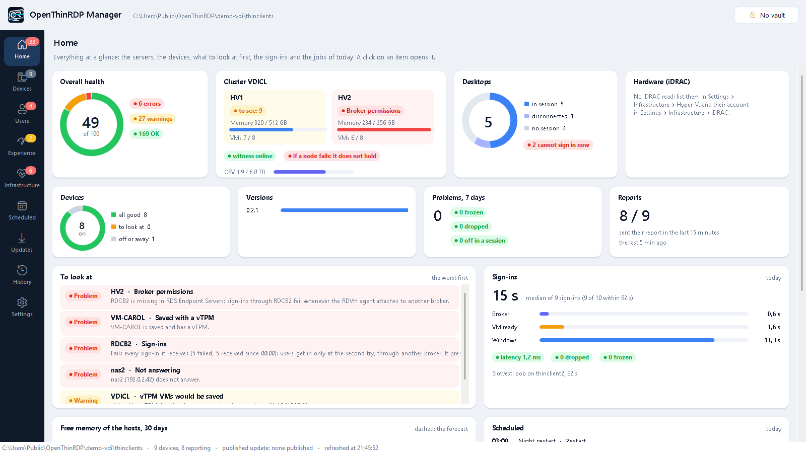
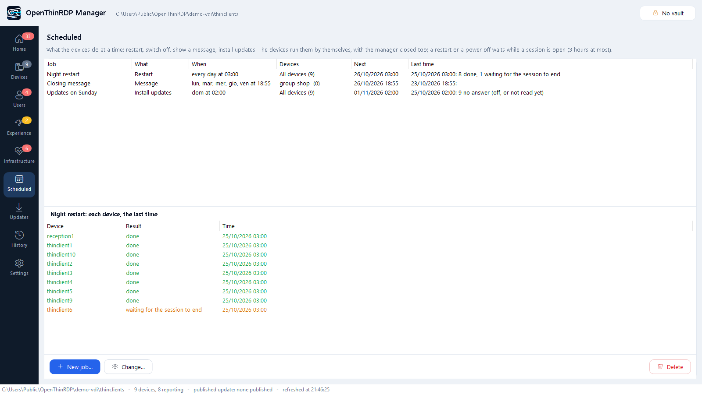
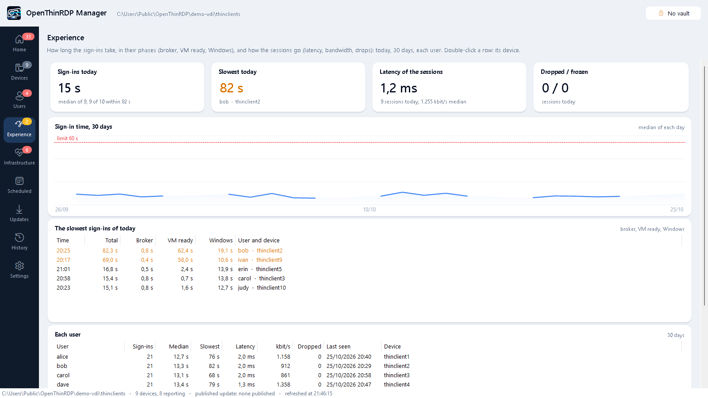
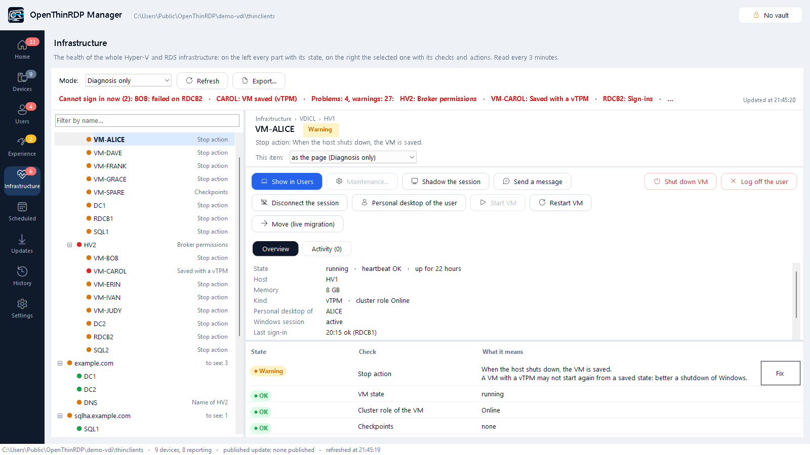
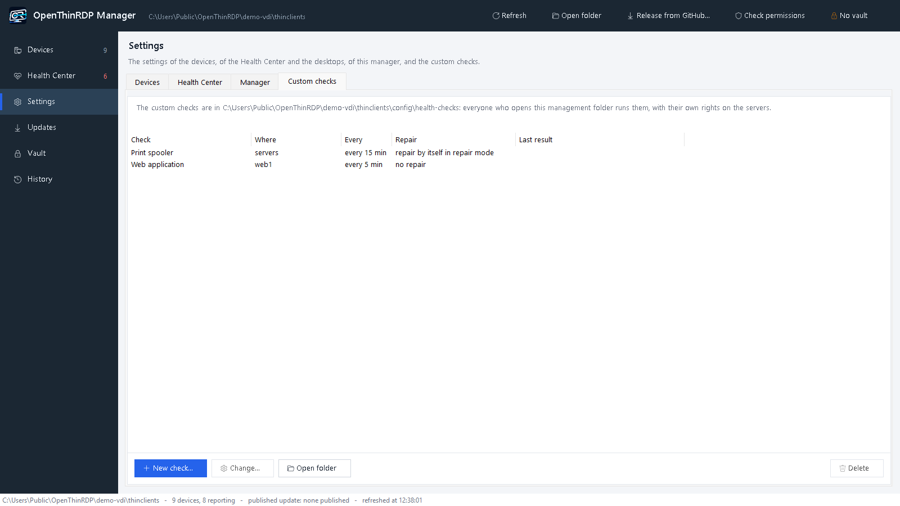

# The OpenThinRDP manager

The OpenThinRDP Manager is a free program for Windows, in English and Italian, with nothing to install. It is two
things in one window:

- **A health center for your Windows infrastructure**, also without any OpenThinRDP device: Hyper-V hosts and failover
  clusters, Remote Desktop Services, domain controllers and DNS, SQL Server AlwaysOn, the backups of the VMs and Dell
  iDRAC. It finds what is wrong, says it in one sentence and repairs it when you confirm. No agent, no server, no
  database; what it runs on your servers is readable. See [a health check for Hyper-V and Remote Desktop](guides/hyper-v-rds-health-check.md).
- **The one place where you run a fleet of OpenThinRDP devices**. It works on the shared folder the devices report
  to: what you see is the files in that folder, and everything you change is a file in that folder too, with a backup
  and a line in the change log.

Download: [its releases](https://github.com/OpenThinRdp/openthinrdp-manager/releases/latest) (or the zip in every
release of OpenThinRDP). Free for any use, closed: [its license](https://github.com/OpenThinRdp/openthinrdp-manager/blob/main/LICENSE.md).

<p align="center">

</p>

- [What you need](#what-you-need)
- [Home: everything at a glance](#home-everything-at-a-glance)
- [Devices: the whole fleet at a glance](#devices-the-whole-fleet-at-a-glance)
- [Peripherals and inventory](#peripherals-and-inventory)
- [Settings for all devices or one](#settings-for-all-devices-or-one)
- [Updates: a few devices first, then all, and back when something breaks](#updates-a-few-devices-first-then-all-and-back-when-something-breaks)
- [Remote screen](#remote-screen)
- [Scheduled jobs](#scheduled-jobs)
- [History: problems across the fleet, and every change](#history-problems-across-the-fleet-and-every-change)
- [Users and desktops: sessions and experience](#users-and-desktops-sessions-and-experience)
- [Health Center: the whole infrastructure](#health-center-the-whole-infrastructure)
- [Vault, keys and the site key](#vault-keys-and-the-site-key)
- [Logo, background, SSH keys, permissions](#logo-background-ssh-keys-permissions)
- [The manager updates itself](#the-manager-updates-itself)
- [Starting it, and the command line](#starting-it-and-the-command-line)

## What you need

- A **shared folder** (SMB) that the devices can read and write their status to: `\\fileserver\thinclients`. How
  to create it, its account and its permissions: [management.md](management.md#account).
- A **Windows 10 or 11 PC** of an administrator, with PowerShell 5.1 (it is part of Windows). For the remote screen,
  also the OpenSSH client of Windows (`ssh.exe`, usually there) and a browser.
- **The manager itself**: `openthinrdp-manager-<version>.zip` from the [latest release of the manager](https://github.com/OpenThinRdp/openthinrdp-manager/releases/latest),
  unpacked into a folder only the administrators can write (a share works, so that everybody starts the same copy).
  From then on it [updates itself](#the-manager-updates-itself).
- The devices set to that folder: `MGMT_SHARE` in their settings dialog, or in the image you build.

Start `OpenThinRDP-Manager.exe` (see [Starting it](#starting-it-and-the-command-line)). The access window is on the
screen at once; the manager loads behind it. The first time without a folder it offers the servers alone, without
devices: the Health Center, the desktops, the cluster and the backups work the same.

The menu on the left, top to bottom: **Home**, **Devices**, **Users** (sessions and experience), **Infrastructure**
(the Health Center), **Scheduled**, **Updates**, **History**, **Settings**. Each item opens one page; what you do
with a device is in its page, what you do with a server is in its page, and the settings of all of it are in
**Settings** (tabs Infrastructure, Manager, Security, Custom checks).

## Home: everything at a glance

**Home** is the first page: the whole fleet in cards, and one list of what to look at.

<p align="center">

</p>

- On top, when the Health Center reads the infrastructure: its health, the cluster and each host, the desktops, the
  hardware of the iDRACs.
- The devices: how many are on, to look at or off, the versions they run, the problems of 7 days, how many report.
- **To look at**, the worst first: the problems of the servers, the devices in error, a required peripheral that is
  gone, slow sign-ins and sessions with a high latency today. A click opens the item, the device or the experience.
- **Sign-ins** of today: the median time and its three phases (the broker, the VM made ready, Windows until the
  desktop), the latency of the sessions, dropped and frozen sessions, the slowest one.
- **Scheduled** for today: what runs, on how many devices, how far it got.
- The free memory of the hosts over 30 days with its forecast, the services over 30 days, the last 24 hours.

The count on **Home** in the menu is how many things there are to look at, red when one is an error.

The infrastructure takes about half a minute to read. Meanwhile **Home** shows the last reading of this PC at once,
with its time on top (*Data from 13:36, the last this PC read: being updated...*), and changes by itself when the new
one comes. The last readings are kept in your profile on this PC (`%LOCALAPPDATA%\OpenThinRDP`), never on the share,
and not shown when older than 3 days.

## Devices: the whole fleet at a glance

The **Devices** page lists every device that reports to the folder, with a coloured dot for its state, the user
signed in, the version it runs and its last report; the search box finds a device by name, address or user. Devices
report every 5 minutes and at boot, and the list refreshes itself every minute. A device that stopped reporting,
rejected the central settings or has a failed service stands out in its colour.

Select a device and its header shows its address, version, last report and user, with its actions: **Remote
screen**, **Logo and background...**, **Software version...**. Under it:

| Tab | What it shows |
|---|---|
| Settings | every setting: the value in use on the device, where it comes from, and the value you set for it |
| Summary | a readable report: session, transport in use (UDP or TCP), network and Wi-Fi, software and FreeRDP, the version it installs, security updates, management, secrets, uptime |
| Inventory | model, serial number, BIOS, addresses and version as the device reports them, and the fields you write: place, inventory number, installation date, notes |
| Peripherals | what is connected now, by kind (printer, scale or serial instrument, card reader, webcam, keyboard...), and which ones are required |
| Events | the event log of the device: sessions, drops with their cause, updates, settings applied or rejected |
| Full report | the status file as the device wrote it |

**Export...** over the list writes every device with its state, addresses, hardware, peripherals and inventory to a
CSV file Excel opens as a table (UTF-8, the list separator of your PC). **Manage groups... > Rules...** places the
new devices by themselves: a device that is in no group goes to the group of the first rule it matches, by its
network (`192.168.5.0/24`), its name (`CASSA*`) or its model (`*OptiPlex 3000*`). A device you moved by hand stays
where it is. The rules are applied by the manager of an administrator, and each move goes to the change log.

## Peripherals and inventory

Each device reports its USB peripherals by kind, and its model, serial number and BIOS (0.2.23 and later). On the
**Peripherals** tab of a device, select one and choose **Required here** or **Required on the group**: from then on, a
device that does not have it connected is on Home and in the notices ("TM-T88V not connected"). The required
peripherals are kept in `health\peripherals.json` of the folder, the fields of the inventory in
`health\inventory.json`: every manager sees the same.


<p align="center">

</p>

## Settings for all devices or one

**Settings > Devices** holds the settings for every device (`config\common.conf`); in a device's **Settings** tab, tick *Exception*
to give that device a value of its own (`config\<hostname>.conf`), which wins over the common one. **Edit as text...**
opens the same file as plain text, comments included: it is saved only after the same checks as the page, in the form
the page would write (a Wi-Fi passphrase becomes its key, a PIN its hash), with the previous file in `config\backup\`.
Passwords show as `********`: leave them to keep them. Every row shows:

- the value **in use on the device** (from its last report);
- **where it comes from**: the device itself, the common settings, or an exception for this device;
- in orange, ***on its way***: a value you saved that the device has not applied yet. It reads the folder every 5
  minutes; when it stays orange, the device has refused the settings (its state says so).

The help of the selected setting is in full under the list. Before saving, the manager checks every value with the
same rules as the devices (a device refuses a whole configuration with one wrong value), and before saving the
common settings it lists the devices that would refuse them. Every save keeps a copy of the file in
`config\backup\` and adds a line to `config\changes.log`.

<p align="center">

</p>

All the settings: [configuration.md](configuration.md).

## Updates: a few devices first, then all, and back when something breaks

The **Updates** page shows the newest version in the folder, the version all devices are on, the pilot devices,
the devices kept on a version of their own, the versions you can choose, and what the devices run now.

<p align="center">

</p>

Everything here is one setting, `UPDATE_TO`, written for you in the right file:

| `UPDATE_TO` | where | means |
|---|---|---|
| `latest` | `common.conf` | every device takes each new version as soon as it is in the folder (the default) |
| a version, e.g. `0.2.0` | `common.conf` | every device stays on that version, or **goes back** to it |
| `latest` | `groups\<group>\_group.conf` | a **pilot group**: its devices take the newest version even while the others stay |
| a version | `<hostname>.conf` | that device stays on, or goes back to, its own version |

A device installs a version also when it is **older** than its own, FreeRDP included, and installs nothing newer
until the setting changes. As always, an update never interrupts a session: it is installed in the background and
applied when the session is over.

**Hours of the updates** (`UPDATE_HOURS`, e.g. `02-05`, also across midnight: `22-06`): the devices download a new
version when it comes, and install it only in those hours. A scheduled job *Install updates* installs at once.

## Scheduled jobs

**Scheduled** lists what the devices do at a time: **restart**, **switch off**, show a **message**, **install
updates**; once, every day or on some days of the week; for all devices, groups or single devices. The devices run
them by themselves, with the manager closed too (`config\jobs.conf`, signed with the site key as the settings are;
read within 5 minutes). For each job the page shows the next time and, for the last one, what each device did:
done, waiting for the session to end, not done because the session stayed open for 3 hours, cancelled by its
user, off at the time, or no answer.

<p align="center">

</p>

A restart or a power off waits while a remote session is open (at most 3 hours), unless the job says *also with a
session open*: then the user sees a 60 s warning and can cancel it. A device that was off at the time does not do it
later. **Schedule...** in the power menu of a device opens a new job for it.

### Try a new version on a few devices

1. **Make a group of pilot devices.** On the **Devices** page, **New group** (e.g. *Pilot*), and move into it
   devices that look like the rest of the fleet (the same model, the same kind of user), with users who will tell
   you when something is odd.
2. **Bring the new version in for that group only.** **Release from GitHub...** (top bar or Updates page)
   downloads the latest release, checks its project signature and hash, and asks: *all devices* or ***only the
   groups ticked*** (one or more). With some groups, all the other devices are first kept on the version they have
   (`UPDATE_TO=<that version>` in `common.conf`), the ticked groups get `UPDATE_TO=latest` in their `_group.conf`,
   and only then the new version goes into the folder. A device follows its own file first, then its group, then
   `common.conf`; a group left on the newest by an earlier release follows `common.conf` again.
3. **Watch the pilots** for a few days: their **Summary** and **Events**, and the **History** page.

**Major updates.** We mark in the release the ones that change how a session connects or runs (**Major update** in
the [CHANGELOG](../CHANGELOG.md), `major=` in the signed `LATEST.txt`). A device with a management folder never
installs one by itself, also when it updates straight from GitHub: only once the manager released it to that
device. **Release from GitHub...** says so above the notes and asks a second time, *No* by default, before it goes
to all devices or to the groups ticked; then it writes `UPDATE_MAJOR` in `common.conf` or in their `_group.conf`.
**Release to all devices** and **Version for all devices...** ask the same before the rest of the fleet gets it.
A device without a management folder asks on its own screen instead ([management.md](management.md#signed-updates)).

### Release it to the whole fleet

When the pilot group is fine: **Updates > Release to all devices**. `common.conf` goes back to `UPDATE_TO=latest`
and every device takes the new version within 5 minutes, each one when its session is over.

### Something broke: go back

- **The whole fleet:** **Updates > Version for all devices...**, choose the version that worked (newest first, from
  `updates\versions\`). Every device goes back to it, FreeRDP included, and stays there.
- **One device:** **Software version...** in its header > *its own version*.
- **A version that is no longer in the folder:** **Version from GitHub...** fetches it (the release `v<version>`,
  with the same checks) into the folder, without changing what the others get.

When the fix is out, **Release from GitHub...** again, pilots first, and **Release to all devices**.

**Good to know**

- Devices go back only to **0.2.0 or later**: older versions do not know `UPDATE_TO`.
- Devices that still run a version **before 0.2.0** ignore `UPDATE_TO` and take the newest version in the folder.
  The manager names them before a pilot-only release: the first time, release 0.2.0 to all devices, or update those
  devices first.
- With `UPDATE_FROM=github` (no management folder for updates) the same setting works: the devices fetch the release
  `v<version>` from GitHub.
- Every published version keeps its signed index in `updates\versions\`; the newest 3 packages stay in the folder,
  plus every version a device is kept on. Details: [management.md](management.md#pilot-devices-and-going-back).

## Remote screen

**Remote screen**, in the header of a device, shows its screen in your browser and lets you use it: to see what a
user sees, or to sign in once to a web page on a screen with no keyboard.

<p align="center">

</p>

It goes **through SSH only**, with the key of the manager's vault and a one-time password: nothing new listens on
the network, and nothing is installed on your PC. The device shows *Remote assistance active* while it lasts and
records it in its events; it ends when you close the small window, or by itself after 2 hours. `REMOTE_SCREEN=off`
turns it off. With `REMOTE_CONSENT=ask` the device first asks its user, at the top of the screen and over the session
too; without *Allow* within a minute it does not start, and the manager says so. How it works:
[management.md](management.md#remote-screen).

## History: problems across the fleet, and every change

The **History** page reads the event logs of every device together, for today, 24 hours, 7 or 30 days, and groups
what went wrong: failed sign-ins (by broker), desktops that did not start, sessions dropped (by cause), sessions
taken over, UDP blocked, failed updates, rejected settings. Each line says how many times, on which devices, for
which users, first and last time. A line is orange when 3 or more devices had the same problem: that points at a
server or the network, not at a device. "Six devices could not reach the broker this morning" is one line instead
of six logs.

The tab **Changes** is the change log of the managers (`config\changes.log`): who changed what and when, newest first,
searchable, with **Export...**.

## Users and desktops: sessions and experience

**Users** in the menu has two tabs. **Experience** says how the users live the fleet: how long each sign-in takes,
split into its phases (the broker, the VM made ready, often started; Windows until the desktop), and how the sessions
go (the latency to the VM, the bandwidth, drops and frozen sessions). Today in four figures, the median sign-in of
the last 30 days against the limit, the slowest sign-ins of today, each user over 30 days. The devices measure it
(0.2.23 and later), the manager keeps it 40 days in `health\experience\`. Over the limits (*Settings >
Infrastructure > Experience of the users*, 60 s and 50 ms by default) a sign-in or a session is on Home and in the
notices.

<p align="center">

</p>

**Sessions** is who works where:
When a user cannot sign in, the cause is often on the Windows side: a broker that fails every request, a host whose
RDVH agent is stuck, a desktop that is saved or off, a session left disconnected. The desktops are part of the
**Health Center**: *who cannot sign in now* opens its headline, each personal desktop (VM) in its tree shows the user,
the Windows session, the last sign-in and the thin client, with the actions on the session (*Shadow*, *Message*,
*Disconnect*, *Log off*) and *Personal desktop of the user*. **Users > Sessions** shows the whole deployment as one
table, searchable: user, device, desktop, host, state of the VM, session, last sign-in. It works with Remote Desktop Services and Hyper-V (personal
desktops, and session hosts when there are some).

<p align="center">

</p>

<p align="center">

</p>

- **One row per user and device**: the device, the personal desktop (VM), its Hyper-V host, the state of the VM
  (running, off, saved, not responding), the Windows session (active, idle for how long, disconnected since when) and
  the last sign-in: when, through which broker, and whether it took a second try.
- **Who cannot sign in now** is on top, in red, and named in one line above the list with what stops them. A colour
  never comes alone: the state says it in words.
- **Select a row**: one sentence says what is wrong, then the desktop, the session, the device and the last sign-ins,
  each with the broker that served or refused it.
- **Its actions**: *Shadow* (the screen of the session, with the user's consent unless the policy of the desktop says
  otherwise), *Message...*, *Disconnect*, *Start VM*, *Restart VM*, *Desktop...* (the personal desktop of the user),
  *Log off*, *Shut down VM*. The same on the row with a right click or the menu key. A button that cannot be used now
  is grey, and its tooltip says why.
- **Filters and search**: problems only, signed in, disconnected, VM off or saved; a user, device, desktop or host.
- The brokers and hosts are read **in the background every 2 minutes** (and with *Refresh*); the page says when. A
  host that does not answer never holds the window.

### Brokers and hosts

The brokers, the shared name the devices use, and the Hyper-V hosts are items of the Health Center tree: one line per
problem, in one sentence and, when a safe fix exists, with its button; **Show all** adds the healthy ones. When all is
well it is one green line, *Brokers and hosts: all OK*. A right click on a broker or a host gives all its actions.

| It checks | Fix |
|---|---|
| **Each broker**: sign-ins received and failed since midnight (or since its service started), and the last ones. A broker that fails every request it receives is an error even when it receives few: users get in at the second try, through another broker, and nobody reports it. Its known signature (it presents itself to itself without the `$` of its computer account, event 4648 of `tssdis.exe`) is named | **Restart**: Tssdis, TScPubRPC and RDMS stop and start again, Tssdis first, with time limits, a hanging process is ended; then its Kerberos tickets are purged |
| Its services, also those stuck in *StopPending* | **Restart** |
| Its database (events 2048, 2072) | |
| The **self-repair** task (below) | **Install** |
| The broker in the AD group of the settings | **Add** |
| **The shared name** (`BROKER` of the devices): every broker behind it, every address answering on port 3389 | |
| **Each host**: every broker in *RDS Endpoint Servers*, *RDS Management Servers* and *Hyper-V Administrators*, directly or through a group (nested groups too). The RDVH agent moves between brokers by itself: a missing permission breaks one broker at random | **Repair**: the AD group of the settings (or the broker's computer account) into the groups that miss it, then the tickets of the brokers |
| *VmHostAgent* and *vmms* stuck, the RDVH agent attached to no broker or with no broker to attach to | **Unblock**: the service stops with a time limit, its process is ended if it hangs, it starts again |
| VMs with a vTPM that the cluster would **save** when it stops them (`OfflineAction` 1): they may not start again | **Correct**: `OfflineAction` 2, shut down |

### Safe by design

- Every action asks first, saying exactly what will happen and to whom (*Signed in there: alice. Her open programs
  close without saving*; for those, *No* is the default), and goes into `config\changes.log` like every other change.
- A broker is restarted only while another one is healthy, and never two at once; one action at a time.
- VMs are shut down (Windows closes inside them), **never saved** and never switched off; a VM of the cluster starts as
  a cluster role.
- What stops or ends something is not offered on data older than 5 minutes: *Refresh* first.
- `OTR_MANAGER_VDI_DRYRUN=1`: every action says what it would run, and runs nothing.

### What it needs

- The manager started as an account that administers the brokers and the Hyper-V hosts, with **WinRM** (port 5985)
  open from the PC to them. The sessions are read from the desktops as `quser` reads them (remote RPC, allowed on a
  Windows 10/11 desktop by `AllowRemoteRPC`); log off, disconnect and message fall back to WinRM on the desktop.
  Without the rights, the page says so in one sentence and the rest of the manager works as before.
- Nothing to configure in most cases: the brokers come from `BROKER` and `BROKER_FALLBACK` of the devices, the active
  management server of the deployment names the other brokers, the hosts and the desktops, the clusters name their
  nodes. **Settings...** on the page (kept for your account on your PC, not in the folder): the **AD group of the
  brokers** (the hosts give their permissions to it, never to single computers), more brokers or hosts if they are not
  found, or the page turned off.
- How it reads them, and why not the RemoteDesktop cmdlets (blind on any server but the active management server):
  `commands\vdi-probe.ps1` of the manager, readable.

### Broker self-repair

A broker can start failing every sign-in after it leaves and joins the farm again: it presents itself without the `$`,
falls back to NTLM, and every request ends with *access denied* (event 804, `0x80070005`) until its services start
again. `rds\Broker-SelfRepair.ps1` of the manager does that by itself, as a scheduled task started by the event
of that fault, at most once every 15 minutes. *Install the broker self-repair* on a broker of the Health Center installs or updates it; by hand:
`Install-BrokerSelfRepair.ps1 -Broker rdcb1.example.com, rdcb2.example.com` (`-Remove` takes it away). A broker that
already has a self-repair task of its own is left as it is.

## Health Center: the whole infrastructure

The sessions answer "who works where, and who cannot sign in". The **Health Center** (**Infrastructure** in the
menu) looks one step further, at what all of it stands on: the Hyper-V hosts and their failover cluster, the storage, the VMs, the
domain controllers, DNS, an SQL AlwaysOn group, the NAS or the witness, the backups. One page instead of Failover
Cluster Manager, Hyper-V Manager, Server Manager, SQL Server Management Studio and the event logs.

<p align="center">

</p>

- **On the left a tree**: cluster, its hosts and their VMs (or *Hyper-V hosts* without a cluster); the domain with its
  DCs and DNS; the SQL listener with its replicas; *Remote Desktop* with the brokers; the devices; the backups. Each
  item has a dot and a word (*Saved with a vTPM*, *Free memory*, *to see: 3*), never the colour alone.
- **On the right the selected item**: what is wrong in one sentence, then **every check it ran with its result**
  (*OK*, *Warning*, *Problem*, each with one short line: *Memory: 41% free*, *Clock: 0.2 s from the domain time*), its facts (up since, Windows, memory, disks,
  clock, addresses, VMs...), its checks (each: what is wrong, with its numbers, and what it means in plain words) with a
  **Fix** button where a fix exists, and its actions (*Drain the node*, *Resume the node*, *Start VM*, *Restart VM*,
  *Shut down VM*, *Move all VMs to the other node*, *Restart the server*, *Shut down the server*, *Resynchronise the
  clock*, *Replicate now*, *Wake up*, *Local administrator password (LAPS)*, and on a personal desktop the session
  actions...). A button that cannot be used now is grey and its tooltip says why.
- **On top** the headline (*Everything OK: 2 hosts, 16 VMs, 2 domain controllers*, or the problems), when it was read,
  and the mode. Read in the background every 3 minutes from the start: the menu shows the count of problems on any page.
- **With the desktops**: the findings of the brokers and hosts show up on the same items (read once, fixed the same
  way); a broker or a host has the actions of the desktops too (restart its services, empty its tickets, install the
  self-repair, unblock the RDVH agent, repair the permissions of the brokers).

<p align="center">

</p>

### What it checks

| Item | Checks |
|---|---|
| **Every server** (host, DC, broker, SQL replica) | free memory and disk, services stuck in *StopPending*/*StartPending*, automatic services stopped with an error, a restart pending (updates), critical events and errors of the last day, the clock against the PDC emulator (SNTP) and where it takes its time from, the secure channel with the domain, active adapters with a 169.254 address |
| **Hyper-V host** | `vmms`, the cluster service, the RDVH agent (when the Desktops page does not watch it), its state in the cluster (up, paused, down), the guardian keys a VM with a vTPM needs on every node |
| **Cluster** | nodes up, the witness online (and its share answering), roles and resources failed, CSVs online and their free space, the storage pool, virtual and physical disks (disks in maintenance while a node is paused are said so), storage repair jobs, cluster networks and the ones live migration may use, *DrainOnShutdown*, VMs with a vTPM it would **save** (`OfflineAction` 1), room on the other nodes for the VMs of each node |
| **VM** | state, heartbeat (not responding), saved (a problem with a vTPM), paused, a running VM whose cluster role is offline (not watched), not a role of the cluster, checkpoints older than 3 days, the stop action of a VM outside a cluster, the disks inside when it answers WinRM by its name |
| **Domain and DCs** | the domain ports from this PC (LDAP, Kerberos, DNS, SMB, global catalog, ADWS), the DC services and their start mode (a *disabled* one is said so), SYSVOL and NETLOGON, inbound replication, the owners of the FSMO roles answering, 127.0.0.1 first in the DNS servers of a DC, the DCs alike (services, DNS zones) |
| **DNS** | every DNS server answers and how fast, every server name resolves to one address of its own and back (a storage or APIPA address registered under the name is the classic way of losing seconds at every connection), reverse lookups that are slow, reverse zones for the networks of the servers |
| **SQL AlwaysOn** (when configured) | the listener and the primary, every replica connected and healthy, every database synchronized (or synchronizing on an asynchronous replica) and not suspended, the SQL services of every replica, the same active logins and SQL Agent jobs on every replica (AlwaysOn copies databases, not logins), failed jobs of the last 3 days, Windows-only authentication on one replica, the last full backup of every database |
| **Hyper-V host, more** | network adapters (up, speed, driver and its date; a driver different from the other node is said), the UPS or battery when Windows sees one (on battery = a problem), the cluster volumes reachable from this node, the vTPM guardian keys |
| **Remote Desktop Gateway, RD Web** (on any server that has them) | the gateway service, its certificate (found, expired, expiring in 30 days), at least one connection and one resource authorization policy, port 443 answering, the failed connections of the last 24 hours; RD Web: the web server running |
| **Devices** | ping, the TCP ports given, an SMB share, Wake-on-LAN; a device that is the file share witness of a cluster says so, and the state of the witness |
| **Custom checks** | your own scripts, on the servers you choose (below) |
| **Backups** (when configured) | the newest file of a log folder, or the newest one with the text of a success, not older than the hours given |

### Diagnosis only, or diagnosis and repair

The **Mode** on top is for the page; **This item** on the right changes one item and what is under it (a cluster and
its hosts, the domain and its DCs). In *Diagnosis only* nothing is changed without a click and a confirmation. In
*Diagnosis and repair* the **safe** repairs of the items in that mode run by themselves after each reading, one after
the other, and each goes into `config\changes.log` (`health: automatic repair: ...: done`); the headline says what was
repaired last. A repair that was tried waits 30 minutes before it is tried again. Turning repair mode on, for the page
or for an item, first lists what it would repair right now, with *No* as the default.

| Safe: runs by itself in repair mode | Always asks |
|---|---|
| Start a service a role needs (`vmms`, the RDVH agent, the cluster service, the DC services, the SQL services of a replica), unless it is **disabled** | Start a disabled service (someone may have disabled it on purpose), or another automatic service that stopped |
| Unblock `vmms`, the RDVH agent or the time service stuck in *StopPending*: stopped with a time limit, its process ended, started again (never `Restart-Service`, which waits for ever) | Unblock any other service; a service of a DC only while another DC is healthy |
| Resynchronise a clock; restart Netlogon when the secure channel is broken | Take the time from the domain again (`w32tm /config /syncfromflags:domhier`) |
| Bring the witness online | Start a failed cluster role; *DrainOnShutdown* = 1 |
| `OfflineAction` 2 for VMs with a vTPM (nothing running is touched) | Drain a node, resume it |
| Wake-on-LAN of a device that does not answer | Start, restart, shut down or resume a VM; bring its cluster role online; remove its old checkpoints; its stop action |
| The safe fixes of the Desktops page: restart the services of a broker (only while another broker is healthy), repair the permissions of the brokers on a host, unblock the RDVH agent | Replicate AD now; create a reverse DNS zone; resume the data movement of a database |

Never, by hand or by itself: a VM saved or switched off (a VM is shut down, Windows closes inside it), two DCs, two SQL
replicas or two brokers acted on within 10 minutes, SQL Server ended or failed over, a server restarted. **Drain the
node** refuses while another node is not up, the witness is not online (or a two-node cluster has none), a storage
repair runs, or the other nodes have not the memory for its VMs: then it moves them live and pauses the node, which can
be restarted; **Resume** puts it back with its VMs. One action at a time on both pages; what stops something is not
offered on data older than 5 minutes; `OTR_MANAGER_VDI_DRYRUN=1` makes every action say what it would run.

### Settings and what it needs

**Settings > Health Center** (the menu entry *Settings*), kept for your account on your PC (`%APPDATA%\OpenThinRDP\manager.json`), not in the
folder. **Nothing is found by itself**: servers can be on other networks or anywhere, so every server is entered by its
role, one list each, with a note for you (a name, a full name or an IPv4 address; a new line at the bottom of a list
adds, *Remove* removes):

- **Hyper-V hosts**, and whether they are in a **failover cluster** (*yes* with the name of the cluster: its other
  nodes and all its VMs are read from it, and the actions use the cluster; *no*: single hosts, each with its own VMs);
- **domain controllers** (the FSMO owners are still asked to AD), **DNS servers** besides the DCs;
- **RD Connection Brokers** and the **shared broker name** of the devices, **RD Gateway**, **RD Web Access**;
- **SQL Server**: the AlwaysOn **listener** (`sqlha.example.com` or `sqlha.example.com,1433`) and its **replicas** (the
  group tells its replicas too; those entered are checked even when the listener does not answer), or **single SQL
  servers**;
- **file servers** and **other Windows servers** (basic checks);
- **devices** (NAS, witness, switches, UPS): the address, the TCP ports to test, an SMB share, a MAC for Wake-on-LAN;
- the **critical VMs** (off = a problem), the **backup log** (a file or a folder, the text of a success, the maximum
  age in hours) and the **thresholds** to change, e.g. `DiskPct=10; MemWarnPct=15`.

A part with nothing in its list says *not configured* in the tree, with a button to this tab. The settings of before
(hosts, DNS servers, servers, devices, and the hosts and brokers of the desktops) move into these lists by themselves,
the first time. Servers given by IP address need WinRM over HTTPS or the address in the WinRM *TrustedHosts*.

The settings of the desktops (collections, the group of the brokers) are in the same tab, *Desktops (brokers)*.

### Notices, and the Health Center without the window

*Settings > Health Center > Notices*: when the problems change, a message with what came and what went to a webhook (or, ticked, structured JSON)
(an incoming webhook of Teams or Slack, anything that takes `{"text": ...}`) and/or a mail through an SMTP relay
without a password. The last state is kept on the PC (`%LOCALAPPDATA%\OpenThinRDP\health-notice.txt`): the window and
a scheduled run on the same PC do not repeat each other.

`OpenThinRDP-Manager.exe -HealthReport -Json C:\otr\health.json` reads the infrastructure once with the settings of
your account and writes the problems as JSON: the time, the state, the counts, each problem with its check, where,
title and text, and the devices with problems in the last 7 days. The exit code is 0 = good, 1 = warnings,
2 = errors, 3 = the reading failed: for Task Scheduler, Zabbix or Prometheus. The notices go from there too. Custom
checks need the vault (their signature), so they wait for the window. **Export...** on top of the page writes the
servers with their state to a CSV file.

**Status page** (*Settings > Infrastructure*): an HTML file with the state of everything, for a phone. Choose where
(a folder that IIS or another web server publishes); the window writes it every 5 minutes and `-HealthReport` at
each run. It holds no script and nothing from outside, refreshes itself every 5 minutes, and says what to look at
first, the devices on, the sign-ins and the servers.

### The summary and the page of an item

The summary of the infrastructure is on **Home**, in cards: the overall health (a ring of the
checks good, to look at and wrong), the cluster with each host (its memory, its VMs, whether it is in maintenance),
the witness and whether the cluster holds if a node fails; the desktops (in session, disconnected, who cannot sign
in); the hardware of the iDRACs; the free memory of the hosts over 30 days with its forecast and the line under which
the VMs of a failed node no longer fit, and how many more desktops like the others there is room for; what to look
at, the worst first (a click opens it); the services over 30 days, one block a day; the last 24 hours of every part,
one box an hour. Each item of the tree opens with its path, its state, its actions on top, then **Overview** (tiles with
its memory, processors, disk, power, each with its trend) and its checks, or **Activity**: what was done on it, from
`config\changes.log`. A filter over the tree finds an item by its name.

### Maintenance

*Maintenance...* on any item: until the time given, its problems and those of what is under it stay in sight, grey,
but they send no notice and nothing is repaired by itself; at that time it is back by itself. Kept in the management
folder (`health\maintenance.json`), so every administrator and the run without the window see it.

### History and forecast

Each reading leaves one line in `health\history` of the management folder (at most every 10 minutes, 40 days): the
free memory, disks, shared volumes, the services and the power of the hosts. From the last two weeks the Health
Center says when a disk, a shared volume or the memory of a host will be full (*Running out*, within
*Warn when full within (days)*, 30 by default). The charts of the summary come from there: a new installation shows
*Collecting* for its first days.

### Services, as their users reach them

*Settings > Health Center > Services*: a web address (`https://...`, with a text the page must contain), a TCP port
(`host:port`) or a database (`sql://server/database`, it connects and runs `SELECT 1`), read from this PC: *Not
answering*, *Wrong page*, *Slow* (over *Service slow over (ms)*, 3000 by default) and the certificate that expires
within 30 days (an error within 7).

### Hardware (Redfish: iDRAC, iLO, XClarity)

*Settings > Health Center > Hyper-V*: the controller of each host (Dell iDRAC, HPE iLO, Lenovo XClarity, Supermicro:
anything that speaks Redfish); *Settings > Manager > Accounts*: one account, read only is enough, kept in the vault. The Health Center reads the power supplies and their redundancy,
the fans, the temperatures, memory, processors and storage, and the power drawn. The certificate of an iDRAC is trusted
the first time it answers and only that one after: another one refuses the connection before the password is sent.
Without the vault open the hardware is not read, and the host says so.

### Certificates and the enterprise CA

Every server the Health Center reads shows its certificates on its page: for whom, issued by whom, until when, what
uses them (RDP, HTTPS of IIS, RD Gateway, SQL Server, WinRM over HTTPS, LDAPS on a domain controller) and whether they
renew by themselves (a template of the CA with auto-enrolment on). A certificate in use warns 30 days before it
expires and is an error in its last week; a renewal left behind is not counted. The domain shows its enterprise CAs,
until when they are valid, and their revocation list: a list past its next update makes every certificate of the CA
fail where revocation is checked.

The Health Center also asks every broker and every running Windows desktop for the certificate it presents on RDP,
without signing in: whether it comes from a CA this PC trusts and is for its name.

**Settings > Security > Enterprise CA**:

- *Request the signing certificate*: a code signing certificate from a template of your CA, into your personal store;
  the manager signs its launcher with it now, after every update, and when the CA renews it (it follows the new one).
  AppLocker and WDAC can then allow the manager by its publisher.
- *Send the CA to the devices*: the certificates of the CAs of your forest go to `config\ca` of the management folder,
  signed as the settings; the devices (0.2.23 and later) add them to the CAs they trust at their next report.
- *RDP certificates of the VMs*: the way of Microsoft, each step shown before it is done. You choose the template: one
  your CA issues already and fits (Server Authentication, the name from Active Directory, the computers of the domain
  may enroll; *Computer* first, so nothing new is made in Active Directory), or the template `OpenThinRDP-RDP` the
  manager creates and publishes on your CA. Then it sets *Server authentication certificate template* in the GPO of
  the desktops you choose (on the PDC emulator, over WinRM). Every VM gets its certificate at its next policy refresh,
  uses it for RDP and renews it by itself. It needs an administrator of the GPO (and of the enterprise to create a
  template).
- *Bind the RDP certificates*: Windows desktops receive the certificate by auto-enrolment but keep their own
  self-signed one for RDP. On every desktop not ready the manager binds the certificate of the CA to its RDP (over
  WinRM, `commands\rdp-bind.ps1`); again after a renewal, when the Health Center shows it not ready.
- *RDP_CERT=verify*: on the groups you choose (the pilot ones first), on every device, or back to what it was; it says
  which servers are not ready before.
- What it says: the CA, the signing certificate, whether the devices have the CA, and how many RDP servers are ready
  for `RDP_CERT=verify` (with the ones that are not, and why: a self-signed certificate, an unknown CA, another name).
  When all are ready, `RDP_CERT=verify` in the common settings: a device then never connects to a server that cannot
  prove who it is. For the desktops, the GPO *Server authentication certificate template* (Remote Desktop Services >
  Remote Desktop Session Host > Security) with a template of your CA.

### Other platforms: Proxmox VE, VMware vSphere, Veeam, Citrix

New in 0.2.23, each an area of *Settings > Health Center* with its own list, and a group of the tree:

| Platform | How it is read | What it checks |
|---|---|---|
| Proxmox VE | its API, port 8006, an API token with the role PVEAuditor | quorum, nodes, memory, storage, HA resources, failed tasks (backups included), failing disks |
| VMware vSphere | the REST API of vCenter (7, 8; 6.7 too), a read-only account | the health of the appliance, hosts disconnected or off, full datastores |
| Veeam Backup & Replication | its REST API, port 9419 (11, 12), an account with the role Veeam Backup Viewer | failed jobs, jobs that stopped running, repositories almost full or offline |
| Citrix Virtual Apps and Desktops | its PowerShell on a Delivery Controller, over WinRM | controllers, unregistered machines, groups without free desktops, licenses in grace period |

The accounts of Proxmox, vCenter and Veeam are kept in the vault (*Settings > Manager > Accounts*); the certificate of
each is trusted the first time it answers and only that one after. Nothing is changed on them: read only. These four
were built against their documented APIs; if you run one of them, [tell us how it reads](https://github.com/OpenThinRdp/openthinrdp-manager/issues).

### Leftovers

What points to something that is gone: the **planned VMs** a live migration or an import left on a host (*Remove the
planned VMs*, refused while a migration runs there; the real VMs are not touched), the **virtual disks** on the
shared volumes that no VM uses (only when every host of the cluster was read; nothing is deleted), the **computers**
of the domain not seen for 90 days.

### The baseline

The settings that break things when they change with nobody touching them: the drain on shutdown, the quorum and the
witness of a cluster; the time source and the enhanced session of a host; the stop and offline actions, memory,
vTPM and clustering of each VM; the time source and the DNS order of a domain controller. The first reading takes them
as they are (`health\baseline.json`); a value that changes is *Changed*, with before and now: **Put it back** (the
offline action, the stop action, the drain on shutdown, the enhanced session) or **Approve as it is**.

### Custom commands

*Settings > Health Center > Custom commands*: your own actions in the **Commands** menu of the items they are for
(hosts, DCs, brokers, SQL, servers, VMs, or names): a script run on the server of the item with your rights (it may
ask one question first, the answer in `$Param`; what it writes is shown), or a **guide** that is only shown (`{name}`
= the name of the item). Each says who may run it (operator or admin). Kept in `config\health-commands`, signed with
the key of the site like the custom checks (changed after = it does not run), never through JEA.

### Backup of the VMs

*Back up the VMs...* on a cluster or a host: all the VMs or some, onto a share (`\\server\share`) that the computer
accounts of the hosts may write. Every host copies its own VMs where they are, none is moved, in a task of its own
(the copy goes on with the window closed): without their memory first (each VM stops for about a second, a session
sees *Connection lost* and comes back), with it when that fails. With them: the settings of the VMs, the certificates
of their vTPM (the password you give is written next to them: whoever has the share has the disks in clear anyway),
and `README-RESTORE.txt` with the four traps of a restore. *Logs of the backup* shows how far it got. A Linux VM
cannot give a copy consistent for its applications (no VSS inside): it is copied with its memory, and the log says
so; before starting it from that copy, `Remove-VMSavedState`.

### The witness and the FSMO roles

A file share witness that is not online says why, read from this PC: the server does not answer on SMB, the share is
not there, the account of the cluster is refused, or the logon (1326); a drained node is not shut down while its
witness is not online. On the domain, *FSMO roles: what to do* shows who holds them and the commands to move them, or
to take them when their owner is lost for good, with what to do after.

### Without administrator rights on the servers (JEA)

By default the Health Center and the Desktops reach the servers over WinRM with your own account, which must be an
administrator of each. *Settings > Health Center > JEA* makes an endpoint called `OpenThinRDP` instead
([Just Enough Administration](https://learn.microsoft.com/powershell/scripting/security/remoting/jea/overview)):
it runs only the readings and actions of this manager, copied into it and named by the fingerprint of their text, as
a virtual account of the server. Two roles, for accounts or groups of the domain:

| Role | What it may do |
|---|---|
| **Operators** | the readings, and the safe repairs with their arguments checked: starting the services each role needs (not a disabled one), unblocking the agent of a host or the services of a broker, the broker tickets, the time, the witness online, the local groups 576/577/578 for computer accounts or the group of the brokers only |
| **Admins** | every action of the manager: restarts, drain, quorum, SQL failover, checkpoints... |

An account in both lists is admin. *Register on the checked* copies the endpoint to the servers checked (with your
rights, once) and restarts WinRM on each 15 seconds later: whatever uses WinRM there drops for a few seconds, so do
it out of hours. Then tick *The Health Center and the Desktops use the endpoint*. After a manager update that changed
its readings or actions, register it again: until then the servers answer that they do not know the action.

Never through the endpoint: the **custom checks** (they run any text, they wait), **LAPS** (on a domain controller the
virtual account is a Domain Admin, so anyone allowed in would read every password: LAPS keeps the rights of your
account) and the **actions inside the VMs** (log off, messages: the VMs have no endpoint). On a domain controller
the endpoint runs as a Domain Admin too: the roles above are what keeps it narrow. Every session is recorded in
`C:\ProgramData\OpenThinRDP\JeaTranscripts` on the server.

**A check that is wrong**: right-click it, *Report a false positive*. The check and what it said, with the names of
your servers, the domain, your user and the addresses replaced (`host1`, `dc1`, `domain`, `ip`), are shown to read and
change; *Open on GitHub* puts them in a new issue, which you still send yourself.

### Custom checks

**Settings > Custom checks** adds your own checks, shown in the tree like the others, on the server they ran on.

**Signed.** A custom check runs on the servers with administrator rights, so whoever could change its scripts in
the folder could run anything there. With a site key in the vault, a check runs only once an administrator signed it:
saving it here signs it, and *Sign* signs one after you read its scripts. A script changed in the folder after the
signature does not run, and the Health Center says which. The signature is checked with the key in the vault, never
with a file of the folder; with the vault closed none runs. A manager without a site key runs them unsigned and says
so.

<p align="center">

</p>


- a **name**, **where** it runs (`hosts`, `dcs`, `brokers`, `sql`, `servers`, or names of servers), **every** how many
  minutes (at least 3), what it means;
- a **diagnostic script**, run on each server over WinRM with the time limits of the Health Center, that returns
  `@{ State = 'ok' | 'warn' | 'error'; Text = 'one short line' }`;
- an optional **repair script** (done when it returns `$true`, `@{ State = 'ok' }` or nothing without an error), and
  whether it is **risky**: a repair that is not risky runs by itself on the items in repair mode, a risky one always
  asks (default *No*).

They are kept in the management folder, `config\health-checks\<id>.json`, `<id>.check.ps1` and `<id>.repair.ps1`, so
everyone who opens the folder runs them, with their own rights on the servers: the Health Center says it in red when
someone other than the administrators can write in that folder. Two examples:

```powershell
# 1. Print spooler running (where: servers; repair: Start-Service Spooler, not risky)
$s = Get-Service Spooler -ErrorAction SilentlyContinue
if (-not $s) { @{ State = 'ok'; Text = 'not installed' } }
elseif ($s.Status -eq 'Running') { @{ State = 'ok'; Text = 'running' } }
else { @{ State = 'error'; Text = "Spooler is $($s.Status)" } }
```

```powershell
# 2. A web application answers its health page (where: the name of its server)
try {
  $r = Invoke-WebRequest -Uri 'https://localhost:5001/healthz' -UseBasicParsing -TimeoutSec 10
  if ($r.StatusCode -eq 200) { @{ State = 'ok'; Text = 'answers' } } else { @{ State = 'warn'; Text = "HTTP $($r.StatusCode)" } }
} catch { @{ State = 'error'; Text = $_.Exception.Message } }
```

Which check of the original runbook script is where: [health-center-coverage.md](health-center-coverage.md).

The manager runs as an account that administers the servers, with **WinRM** (5985) to the hosts, DCs, brokers and SQL
replicas, NTP (UDP 123) from them to the PDC emulator, and a login on every SQL replica (Windows authentication). The
probe only reads: `Get-*` commands, `repadmin /showrepl`, `w32tm /query`, `SELECT` on SQL; how it reads and why:
`commands\health-probe.ps1` of the manager, readable, as every command it runs on servers (`commands\`, `rds\`).
Without rights on a server the item says so in one
sentence and the rest goes on.

## Access by account and levels

*Settings > Manager > Access* replaces the one code for everybody with one access per person or group:

- **A user or a group of the domain**: its members open the manager with their Windows account, nothing to type
  (DPAPI-NG: the domain unlocks the vault for them, on any PC of the domain).
- **An account of the manager**: a name and a password, for someone outside the domain.
- **The emergency code**: the access code of before, kept as an administrator access for when the domain does not
  answer. Keep it offline.

Each access has a **level**: *Administrator* (everything), *Operator* (commands to the devices, their remote screen,
the actions on desktops; no settings, no releases, no vault), *Read only* (sees everything, changes nothing). The
levels are inside the encrypted vault, so whoever can write the file cannot raise their own. Removing an access gives
the content a new key: a copy of the old access opens nothing that comes after (the domain accesses follow by
themselves, the accounts of the manager get a new password then). `config\changes.log` names the Windows user and,
for an account of the manager, that account.

**Rights on the folder** sets them on the management folder for the domain accesses: administrators may change
`config\`, `updates\` and `diag\`, the others read. Rights from other groups stay as they are: a level is real only
when nobody below *Administrator* can write `config\` some other way.

## Vault, keys and the site key

All of this is in **Settings > Security**, with who opens the manager and at which level. The access window at the
start opens the vault: once in, it stays open. **Lock** in the top bar closes it and asks for the access again,
for when you leave the PC; with Windows accounts locking Windows does that, and the button is not there.

Two keys rule the fleet: the SSH key that opens the screen of any device, and the key that signs the update packages
every device installs. The manager keeps both in `vault.otr`, next to it, encrypted with an **access code** that only
the administrators know. Every administrator who starts the same copy opens it with the same code; without the code
the settings can still be edited, but no screen opens and nothing is signed.

**The access code first.** When a copy of the manager has a vault, it asks the code before anything else: no folder,
no device, no window behind the question. A wrong code says so and lets you try again (after three, each try waits
longer: 2, 4, 8, 16, then 30 seconds); **Exit** or the close box ends the manager. With the right code the vault stays
open for the session: the remote screen and signing do not ask again. A copy without a vault starts as before and offers
to create one.

<p align="center">

</p>

The **Vault** page has the vault itself, the key that signs the updates, the SSH key of the manager and, under them,
the **SSH keys of the devices**: the public keys `otradmin` accepts on the devices with `SSH=on` (`config\authorized_keys`),
one per line, with **Save**, **Undo changes**, **Add the key of the manager** and **Add a key from a file...**.

<p align="center">

</p>

**A fleet on its own key.** With `UPDATE_KEY=site` your devices accept only updates signed by the key of your site,
which exists only in your vault. The manager checks each GitHub release (project signature and hash) and signs it
again with your key: a stolen project key installs nothing on your fleet. Set it up step by step:
[management.md](management.md#a-fleet-on-its-own-key).

## Logo, background, SSH keys, permissions

- **Logo and background...** (common settings, or a device): any picture, scaled and saved as PNG, for every device
  or one.
- **SSH keys of the devices** (on the Vault page): the keys of the administrators, sent to every device (`SSH=on`);
  **Add the key of the manager** puts the vault's key there for the remote screen.
- **Check permissions** tells you what the account of the devices can do in the folder: it needs to write only its
  status, never the settings or the updates.
- The window fits any screen, from a 27" monitor to a laptop with display scaling (down to 860×560).

## The manager updates itself

Since 1.0.0 the manager has [releases of its own](https://github.com/OpenThinRdp/openthinrdp-manager/releases),
numbered apart from the devices and signed with the same project key (up to 0.2.27 it came with each release of the
devices, with their number). At start, in the background, the manager checks its latest release; when there is a
newer manager, the top bar shows
***Manager X available***. **Update the manager** downloads it, checks signature and hash, keeps the files it
replaces in `previous\`, and starts again. Your `vault.otr`, the launcher and anything that is not part of the
manager stay as they are; if anything fails, the previous files come back.

Update the copy the administrators start (on a share, from a PC that can write there): everybody who starts it gets
the new version. The **Updates** page shows the manager's version and has **Check again**. Details:
[management.md](management.md#the-manager-updates-itself).

### Files as the release signed them

Whoever can write in the folder of the manager could change it to work on your servers with your credentials. From
0.2.23 the manager of a release carries `MANIFEST.txt`, the SHA-256 of each of its files, signed with the project
key. The launcher (`OpenThinRDP-Manager.exe`) checks it before anything of the manager runs: a file changed or
missing, or a script, C# source, language file or library added next to them, and the manager does not start, with
the list of those files. The key is the one written in the launcher, not just any key in the folder.

- A copy without `MANIFEST.txt` (a development copy, a manager you built without the project key) starts as before,
  unless this PC already opened it signed: taking `MANIFEST.txt` away does not turn the check off. If that is wanted,
  the message names the file to delete in your profile.
- An update brings the new `MANIFEST.txt`, and moves to `previous\` the code the new release no longer has.
- The launchers are built again only from signed files.
- The check covers the starts through the launcher. Who can write in the folder can still change the launcher on the
  share itself: start the manager from the copy `OpenThinRDP-Manager.exe -Install` puts on each PC (on its own disk).
- The manager itself is sealed in `OpenThinRDP-Manager.core` and runs from memory; what it runs on your servers is in
  `commands\` and `rds\`, readable, and checked against `MANIFEST.txt` before it is loaded.

## Power and commands of a device

**Power and commands** in the header of a device:

- **Power on (Wake-on-LAN)**: the magic packet to the broadcast of the network the device last reported (e.g.
  `192.168.1.255` for `192.168.0.37/23`) and to `255.255.255.255`. It needs Wake-on-LAN in the BIOS; the device
  enables it on its network card at every start.
- **Restart**, **Switch off**, **Send its status now**, **Run a command...**: over SSH as `otradmin` with the key of
  the vault (SSH on for the device). Restart and switch off warn when someone is working on the device; a command
  shows its output and exit code (`sudo` in front for root). Every action goes to the change log.

## Settings > Manager: language and local copy

- **Code signing**: where only signed programs run (AppLocker, WDAC), *Sign the manager* signs its launcher with a code
  signing certificate of yours (Current user > Personal, from the CA of the site), again after every update. The
  manager does not run from script files, so AllSigned does not stop it.

- **Management folder > Name it in the domain** (#82): writes `<account>=<folder>` into
  `\\<domain>\NETLOGON\OpenThinRDP\folders.conf`, for the account of the devices (`MGMT_USER` of the common
  settings). A device with that account and **no folder of its own** finds the folder there at every report: a new
  device needs only domain, account and password. NETLOGON is on every DC and every domain account reads it over the
  SMB the device uses anyway; no LDAP on the device (LDAP signing, or a domain without an LDAPS certificate, would
  refuse it). The last folder found is kept for when no DC answers. Writing NETLOGON needs a domain administrator.
- **Management folder > Move the folder...**: copies everything to a new network path, points `MGMT_SHARE` to it in
  every `.conf` of both copies (and adds it to the old `common.conf`), updates the domain entry when there is one, and
  goes on working on the new folder. Every device moves at its next report, those switched off when they start; the
  old folder stays until no device reports there any more.

- **Language**: the language of the window for your Windows user (*Language of Windows* = as today); it applies from
  the next start. `-Language` on the command line still wins.
- **Local copy of the management folder**: choose a folder on this PC and the manager mirrors the management folder
  there in the background at every start (and with *Update the copy now*), without the packages of the old versions.
  When the file server is down, the manager offers to open the local copy, so the Health Center works when it is
  needed most; *Open the local copy* opens it by hand, or start with `-Folder <local copy>`. The title says *(LOCAL
  COPY)*: what is changed there stays there and does not reach the file server.
- **The manager updates itself**: its block is on the Updates page, under the updates of the devices.

## Starting it, and the command line

- `OpenThinRDP-Manager.exe` starts it: the access window at once, the manager loading behind it.
  `OpenThinRDP-Manager.exe -Install [-Name <name>] [-Folder <folder>] [-Language en|it]` puts a copy on this PC with a
  shortcut on the desktop, that starts the manager on the share ([details](management.md#central-settings)). An
  update brings a newer launcher in place of the older ones by itself; the `.cmd` and `.vbs` of the releases before
  0.2.23 go.
- `OpenThinRDP-Manager.exe -Folder \\fileserver\thinclients -Language en|it`: the folder and the language (by default
  the Windows display language).
- `OpenThinRDP-Manager.exe -Sign <folder>\LATEST.txt`: signs an update package you built with `make-update.sh`, with
  the key in the vault ([Signed updates](management.md#signed-updates)).
- `OpenThinRDP-Manager.exe -UpdateManager`: updates the manager without a window (exit code 0 = updated, 1 = error,
  2 = nothing to do).
- `OpenThinRDP-Manager.exe -HealthReport -Json <file>`: the Health Center once, without a window
  ([details](#notices-and-the-health-center-without-the-window)). With these three the launcher waits for the manager
  and gives back its exit code and its output, for Task Scheduler and scripts.
- The manager is free for any use, closed, under [its own license](https://github.com/OpenThinRdp/openthinrdp-manager/blob/main/LICENSE.md); its releases and issues
  are on [its project](https://github.com/OpenThinRdp/openthinrdp-manager).

What is in the folder, file by file, and how the devices use it: [management.md](management.md).
