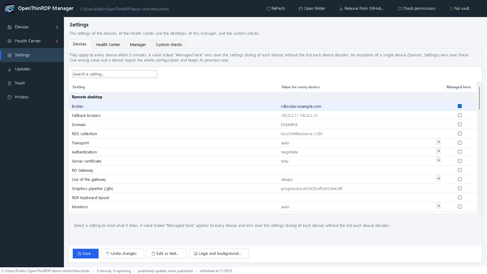
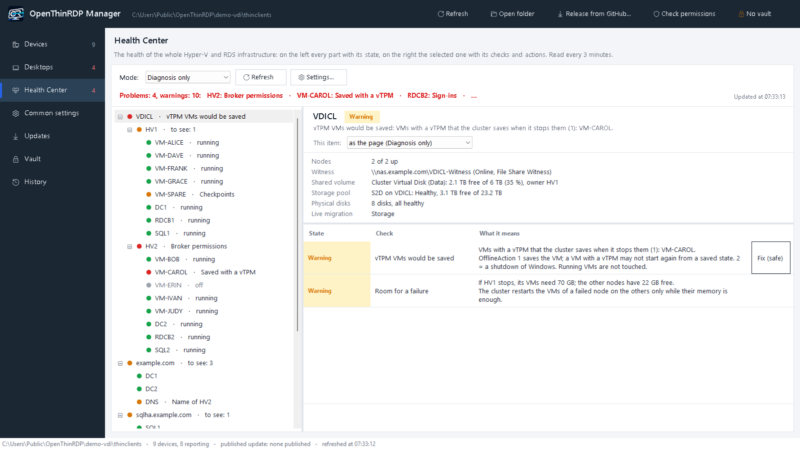
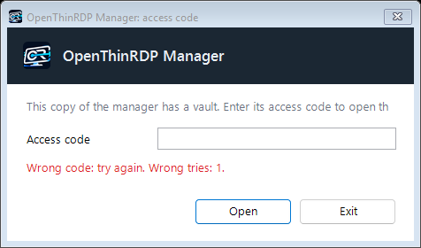

# The OpenThinRDP manager

The manager is the one place where you run a fleet of OpenThinRDP devices: one PowerShell script for Windows 10/11,
in English and Italian, with nothing to install. It works on the shared folder the devices report to: no server,
no agent, no database. What you see is the files in that folder, and everything you change is a file in that
folder too, with a backup and a line in the change log.

- [What you need](#what-you-need)
- [Devices: the whole fleet at a glance](#devices-the-whole-fleet-at-a-glance)
- [Settings for all devices or one](#settings-for-all-devices-or-one)
- [Updates: a few devices first, then all, and back when something breaks](#updates-a-few-devices-first-then-all-and-back-when-something-breaks)
- [Remote screen](#remote-screen)
- [History: problems across the fleet](#history-problems-across-the-fleet)
- [Desktops, brokers and Hyper-V hosts](#desktops-brokers-and-hyper-v-hosts)
- [Health Center: the whole infrastructure](#health-center-the-whole-infrastructure)
- [Vault, keys and the site key](#vault-keys-and-the-site-key)
- [Logo, background, SSH keys, permissions](#logo-background-ssh-keys-permissions)
- [The manager updates itself](#the-manager-updates-itself)
- [Starting it, and the command line](#starting-it-and-the-command-line)

## What you need

- A **shared folder** (SMB) that the devices can read and write their status to: `\\fileserver\thinclients`. How
  to create it, its account and its permissions: [management.md](management.md#account).
- A **Windows 10 or 11 PC** of an administrator, with PowerShell 5.1 (it is part of Windows). For the remote screen,
  also the OpenSSH client of Windows (`ssh.exe`, usually there) and a browser.
- **The manager itself**: `openthinrdp-manager-<version>.zip` from the [latest release](https://github.com/OpenThinRdp/openthinrdp/releases/latest),
  unpacked into a folder only the administrators can write (a share works, so that everybody starts the same copy).
  From then on it [updates itself](#the-manager-updates-itself).
- The devices set to that folder: `MGMT_SHARE` in their settings dialog, or in the image you build.

Start `OpenThinRDP-Manager.vbs` (no console window) or `OpenThinRDP-Manager.cmd -Folder \\fileserver\thinclients`.

## Devices: the whole fleet at a glance

The **Devices** page lists every device that reports to the folder, with a coloured dot for its state, the user
signed in, the version it runs and its last report; the search box finds a device by name, address or user. Devices
report every 5 minutes and at boot, and the list refreshes itself every minute. A device that stopped reporting,
rejected the central settings or has a failed service stands out in its colour.

Select a device and its header shows its address, version, last report and user, with its actions: **Remote
screen**, **Logo and background...**, **Software version...**. Under it:

| Tab | What it shows |
|---|---|
| Settings | every setting: the value in use on the device, where it comes from, and the value you set for it |
| Summary | a readable report: session, transport in use (UDP or TCP), network and Wi-Fi, software and FreeRDP, the version it installs, security updates, management, secrets, uptime |
| Events | the event log of the device: sessions, drops with their cause, updates, settings applied or rejected |
| Full report | the status file as the device wrote it |

## Settings for all devices or one

**Common settings** are for every device (`config\common.conf`); in a device's **Settings** tab, tick *Exception*
to give that device a value of its own (`config\<hostname>.conf`), which wins over the common one. Every row shows:

- the value **in use on the device** (from its last report);
- **where it comes from**: the device itself, the common settings, or an exception for this device;
- in orange, ***on its way***: a value you saved that the device has not applied yet. It reads the folder every 5
  minutes; when it stays orange, the device has refused the settings (its state says so).

The help of the selected setting is in full under the list. Before saving, the manager checks every value with the
same rules as the devices (a device refuses a whole configuration with one wrong value), and before saving the
common settings it lists the devices that would refuse them. Every save keeps a copy of the file in
`config\backup\` and adds a line to `config\changes.log`.

All the settings: [configuration.md](configuration.md).

## Updates: a few devices first, then all, and back when something breaks

The **Updates** page shows the newest version in the folder, the version all devices are on, the pilot devices,
the devices kept on a version of their own, the versions you can choose, and what the devices run now.

Everything here is one setting, `UPDATE_TO`, written for you in the right file:

| `UPDATE_TO` | where | means |
|---|---|---|
| `latest` | `common.conf` | every device takes each new version as soon as it is in the folder (the default) |
| a version, e.g. `0.2.0` | `common.conf` | every device stays on that version, or **goes back** to it |
| `latest` | `<hostname>.conf` | a **pilot device**: it takes the newest version even while the others stay |
| a version | `<hostname>.conf` | that device stays on, or goes back to, its own version |

A device installs a version also when it is **older** than its own, FreeRDP included, and installs nothing newer
until the setting changes. As always, an update never interrupts a session: it is installed in the background and
applied when the session is over.

### Try a new version on a few devices

1. **Choose the pilots.** In the header of a device, **Software version...** > *pilot device*. Pick devices that
   look like the rest of the fleet (the same model, the same kind of user), and users who will tell you when
   something is odd. The list marks them *(pilot)*.
2. **Bring the new version in for the pilots only.** **Release from GitHub...** (top bar or Updates page) downloads
   the latest release, checks its project signature and hash, and asks: *all devices* or ***pilot devices only***.
   With pilot only, all the other devices are first kept on the version they have (`UPDATE_TO=<that version>` in
   `common.conf`), and only then the new version goes into the folder.
3. **Watch the pilots** for a few days: their **Summary** and **Events**, and the **History** page.

### Release it to the whole fleet

When the pilots are fine: **Updates > Release to all devices**. `common.conf` goes back to `UPDATE_TO=latest`
and every device takes the new version within 5 minutes, each one when its session is over.

### Something broke: go back

- **The whole fleet:** **Updates > Version for all devices...**, choose the version that worked (newest first, from
  `updates\versions\`). Every device goes back to it, FreeRDP included, and stays there.
- **One device:** **Software version...** in its header > *its own version*.
- **A version that is no longer in the folder:** **Version from GitHub...** fetches it (the release `v<version>`,
  with the same checks) into the folder, without changing what the others get.

When the fix is out, **Release from GitHub...** again, pilots first, and **Release to all devices**.

**Good to know**

- Devices go back only to **0.2.0 or later**: older versions do not know `UPDATE_TO`.
- Devices that still run a version **before 0.2.0** ignore `UPDATE_TO` and take the newest version in the folder.
  The manager names them before a pilot-only release: the first time, release 0.2.0 to all devices, or update those
  devices first.
- With `UPDATE_FROM=github` (no management folder for updates) the same setting works: the devices fetch the release
  `v<version>` from GitHub.
- Every published version keeps its signed index in `updates\versions\`; the newest 3 packages stay in the folder,
  plus every version a device is kept on. Details: [management.md](management.md#pilot-devices-and-going-back).

## Remote screen

**Remote screen**, in the header of a device, shows its screen in your browser and lets you use it: to see what a
user sees, or to sign in once to a web page on a screen with no keyboard.

It goes **through SSH only**, with the key of the manager's vault and a one-time password: nothing new listens on
the network, and nothing is installed on your PC. The device shows *Remote assistance active* while it lasts and
records it in its events; it ends when you close the small window, or by itself after 2 hours. `REMOTE_SCREEN=off`
turns it off. How it works: [management.md](management.md#remote-screen).

## History: problems across the fleet

The **History** page reads the event logs of every device together, for today, 24 hours, 7 or 30 days, and groups
what went wrong: failed sign-ins (by broker), desktops that did not start, sessions dropped (by cause), sessions
taken over, UDP blocked, failed updates, rejected settings. Each line says how many times, on which devices, for
which users, first and last time. A line is orange when 3 or more devices had the same problem: that points at a
server or the network, not at a device. "Six devices could not reach the broker this morning" is one line instead
of six logs.

## Desktops, brokers and Hyper-V hosts

When a user cannot sign in, the cause is often on the Windows side: a broker that fails every request, a host whose
RDVH agent is stuck, a desktop that is saved or off, a session left disconnected. The **Desktops** page shows that side
next to the devices, for a deployment of Remote Desktop Services with Hyper-V (personal desktops, and session hosts when
there are some).

- **One row per user and device**: the device, the personal desktop (VM), its Hyper-V host, the state of the VM
  (running, off, saved, not responding), the Windows session (active, idle for how long, disconnected since when) and
  the last sign-in: when, through which broker, and whether it took a second try.
- **Who cannot sign in now** is on top, in red, and named in one line above the list with what stops them. A colour
  never comes alone: the state says it in words.
- **Select a row**: one sentence says what is wrong, then the desktop, the session, the device and the last sign-ins,
  each with the broker that served or refused it.
- **Its actions**: *Shadow* (the screen of the session, with the user's consent unless the policy of the desktop says
  otherwise), *Message...*, *Disconnect*, *Start VM*, *Restart VM*, *Desktop...* (the personal desktop of the user),
  *Log off*, *Shut down VM*. The same on the row with a right click or the menu key. A button that cannot be used now
  is grey, and its tooltip says why.
- **Filters and search**: problems only, signed in, disconnected, VM off or saved; a user, device, desktop or host.
- The brokers and hosts are read **in the background every 2 minutes** (and with *Refresh*); the page says when. A
  host that does not answer never holds the window.

### Brokers and hosts

On top of the **Desktops** page, the brokers, the shared name the devices use, and the Hyper-V hosts: one line per
problem, in one sentence and, when a safe fix exists, with its button; **Show all** adds the healthy ones. When all is
well it is one green line, *Brokers and hosts: all OK*. A right click on a broker or a host gives all its actions.

| It checks | Fix |
|---|---|
| **Each broker**: sign-ins received and failed since midnight (or since its service started), and the last ones. A broker that fails every request it receives is an error even when it receives few: users get in at the second try, through another broker, and nobody reports it. Its known signature (it presents itself to itself without the `$` of its computer account, event 4648 of `tssdis.exe`) is named | **Restart**: Tssdis, TScPubRPC and RDMS stop and start again, Tssdis first, with time limits, a hanging process is ended; then its Kerberos tickets are purged |
| Its services, also those stuck in *StopPending* | **Restart** |
| Its database (events 2048, 2072) | |
| The **self-repair** task (below) | **Install** |
| The broker in the AD group of the settings | **Add** |
| **The shared name** (`BROKER` of the devices): every broker behind it, every address answering on port 3389 | |
| **Each host**: every broker in *RDS Endpoint Servers*, *RDS Management Servers* and *Hyper-V Administrators*, directly or through a group (nested groups too). The RDVH agent moves between brokers by itself: a missing permission breaks one broker at random | **Repair**: the AD group of the settings (or the broker's computer account) into the groups that miss it, then the tickets of the brokers |
| *VmHostAgent* and *vmms* stuck, the RDVH agent attached to no broker or with no broker to attach to | **Unblock**: the service stops with a time limit, its process is ended if it hangs, it starts again |
| VMs with a vTPM that the cluster would **save** when it stops them (`OfflineAction` 1): they may not start again | **Correct**: `OfflineAction` 2, shut down |

### Safe by design

- Every action asks first, saying exactly what will happen and to whom (*Signed in there: alice. Her open programs
  close without saving*; for those, *No* is the default), and goes into `config\changes.log` like every other change.
- A broker is restarted only while another one is healthy, and never two at once; one action at a time.
- VMs are shut down (Windows closes inside them), **never saved** and never switched off; a VM of the cluster starts as
  a cluster role.
- What stops or ends something is not offered on data older than 5 minutes: *Refresh* first.
- `OTR_MANAGER_VDI_DRYRUN=1`: every action says what it would run, and runs nothing.

### What it needs

- The manager started as an account that administers the brokers and the Hyper-V hosts, with **WinRM** (port 5985)
  open from the PC to them. The sessions are read from the desktops as `quser` reads them (remote RPC, allowed on a
  Windows 10/11 desktop by `AllowRemoteRPC`); log off, disconnect and message fall back to WinRM on the desktop.
  Without the rights, the page says so in one sentence and the rest of the manager works as before.
- Nothing to configure in most cases: the brokers come from `BROKER` and `BROKER_FALLBACK` of the devices, the active
  management server of the deployment names the other brokers, the hosts and the desktops, the clusters name their
  nodes. **Settings...** on the page (kept for your account on your PC, not in the folder): the **AD group of the
  brokers** (the hosts give their permissions to it, never to single computers), more brokers or hosts if they are not
  found, or the page turned off.
- How it reads them, and why not the RemoteDesktop cmdlets (blind on any server but the active management server): the
  comments at the top of `management/windows/OtrVdi.ps1`.

### Broker self-repair

A broker can start failing every sign-in after it leaves and joins the farm again: it presents itself without the `$`,
falls back to NTLM, and every request ends with *access denied* (event 804, `0x80070005`) until its services start
again. `management/windows/rds/Broker-SelfRepair.ps1` does that by itself, as a scheduled task started by the event
of that fault, at most once every 15 minutes. **Install** in Brokers and hosts (Desktops page) installs or updates it; by hand:
`Install-BrokerSelfRepair.ps1 -Broker rdcb1.example.com, rdcb2.example.com` (`-Remove` takes it away). A broker that
already has a self-repair task of its own is left as it is.

## Health Center: the whole infrastructure

The Desktops page answers "who cannot sign in, and which broker or host stops them". The **Health Center** looks one
step further, at what all of it stands on: the Hyper-V hosts and their failover cluster, the storage, the VMs, the
domain controllers, DNS, an SQL AlwaysOn group, the NAS or the witness, the backups. One page instead of Failover
Cluster Manager, Hyper-V Manager, Server Manager, SQL Server Management Studio and the event logs.

- **On the left a tree**: cluster, its hosts and their VMs (or *Hyper-V hosts* without a cluster); the domain with its
  DCs and DNS; the SQL listener with its replicas; *Remote Desktop* with the brokers; the devices; the backups. Each
  item has a dot and a word (*Saved with a vTPM*, *Free memory*, *to see: 3*), never the colour alone.
- **On the right the selected item**: what is wrong in one sentence, its facts (up since, Windows, memory, disks,
  clock, addresses, VMs...), its checks (each: what is wrong, with its numbers, and what it means in plain words) with a
  **Fix** button where a fix exists, and its actions (*Drain the node*, *Resume the node*, *Start VM*, *Restart VM*,
  *Shut down VM*, *Resynchronise the clock*, *Replicate now*, *Wake up*...). A button that cannot be used now is grey and
  its tooltip says why.
- **On top** the headline (*Everything OK: 2 hosts, 16 VMs, 2 domain controllers*, or the problems), when it was read,
  and the mode. Read in the background every 3 minutes from the start: the menu shows the count of problems on any page.
- **With the Desktops page**: the findings of the brokers and hosts there show up on the same items here (read once,
  fixed the same way); *Open in Desktops* on a personal desktop or a broker, *Show in Health Center* with a right click
  on a host, a broker or a user there.

### What it checks

| Item | Checks |
|---|---|
| **Every server** (host, DC, broker, SQL replica) | free memory and disk, services stuck in *StopPending*/*StartPending*, automatic services stopped with an error, a restart pending (updates), critical events and errors of the last day, the clock against the PDC emulator (SNTP) and where it takes its time from, the secure channel with the domain, active adapters with a 169.254 address |
| **Hyper-V host** | `vmms`, the cluster service, the RDVH agent (when the Desktops page does not watch it), its state in the cluster (up, paused, down), the guardian keys a VM with a vTPM needs on every node |
| **Cluster** | nodes up, the witness online (and its share answering), roles and resources failed, CSVs online and their free space, the storage pool, virtual and physical disks (disks in maintenance while a node is paused are said so), storage repair jobs, cluster networks and the ones live migration may use, *DrainOnShutdown*, VMs with a vTPM it would **save** (`OfflineAction` 1), room on the other nodes for the VMs of each node |
| **VM** | state, heartbeat (not responding), saved (a problem with a vTPM), paused, a running VM whose cluster role is offline (not watched), not a role of the cluster, checkpoints older than 3 days, the stop action of a VM outside a cluster, the disks inside when it answers WinRM by its name |
| **Domain and DCs** | the domain ports from this PC (LDAP, Kerberos, DNS, SMB, global catalog, ADWS), the DC services and their start mode (a *disabled* one is said so), SYSVOL and NETLOGON, inbound replication, the owners of the FSMO roles answering, 127.0.0.1 first in the DNS servers of a DC, the DCs alike (services, DNS zones) |
| **DNS** | every DNS server answers and how fast, every server name resolves to one address of its own and back (a storage or APIPA address registered under the name is the classic way of losing seconds at every connection), reverse lookups that are slow, reverse zones for the networks of the servers |
| **SQL AlwaysOn** (when configured) | the listener and the primary, every replica connected and healthy, every database synchronized (or synchronizing on an asynchronous replica) and not suspended, the SQL services of every replica, the same active logins and SQL Agent jobs on every replica (AlwaysOn copies databases, not logins), failed jobs of the last 3 days, Windows-only authentication on one replica, the last full backup of every database |
| **Devices** | ping, the TCP ports given, an SMB share; the host of a file share witness is watched by itself |
| **Backups** (when configured) | the newest file of a log folder, or the newest one with the text of a success, not older than the hours given |

### Diagnosis only, or diagnosis and repair

The **Mode** on top is for the page; **This item** on the right changes one item and what is under it (a cluster and
its hosts, the domain and its DCs). In *Diagnosis only* nothing is changed without a click and a confirmation. In
*Diagnosis and repair* the **safe** repairs of the items in that mode run by themselves after each reading, one after
the other, and each goes into `config\changes.log` (`health: automatic repair: ...: done`); the headline says what was
repaired last. A repair that was tried waits 30 minutes before it is tried again.

| Safe: runs by itself in repair mode | Always asks |
|---|---|
| Start a service a role needs (`vmms`, the RDVH agent, the cluster service, the DC services, the SQL services of a replica), unless it is **disabled** | Start a disabled service (someone may have disabled it on purpose), or another automatic service that stopped |
| Unblock `vmms`, the RDVH agent or the time service stuck in *StopPending*: stopped with a time limit, its process ended, started again (never `Restart-Service`, which waits for ever) | Unblock any other service; a service of a DC only while another DC is healthy |
| Resynchronise a clock; restart Netlogon when the secure channel is broken | Take the time from the domain again (`w32tm /config /syncfromflags:domhier`) |
| Bring the witness online | Start a failed cluster role; *DrainOnShutdown* = 1 |
| `OfflineAction` 2 for VMs with a vTPM (nothing running is touched) | Drain a node, resume it |
| Wake-on-LAN of a device that does not answer | Start, restart, shut down or resume a VM; bring its cluster role online; remove its old checkpoints; its stop action |
| The safe fixes of the Desktops page: restart the services of a broker (only while another broker is healthy), repair the permissions of the brokers on a host, unblock the RDVH agent | Replicate AD now; create a reverse DNS zone; resume the data movement of a database |

Never, by hand or by itself: a VM saved or switched off (a VM is shut down, Windows closes inside it), two DCs, two SQL
replicas or two brokers acted on within 10 minutes, SQL Server ended or failed over, a server restarted. **Drain the
node** refuses while another node is not up, the witness is not online (or a two-node cluster has none), a storage
repair runs, or the other nodes have not the memory for its VMs: then it moves them live and pauses the node, which can
be restarted; **Resume** puts it back with its VMs. One action at a time on both pages; what stops something is not
offered on data older than 5 minutes; `OTR_MANAGER_VDI_DRYRUN=1` makes every action say what it would run.

### Settings and what it needs

**Settings...** on the page, kept for your account on your PC (`%APPDATA%\OpenThinRDP\manager.json`), not in the
folder. Most of it is found by itself: the hosts of the Desktops page and the nodes of their clusters, the VMs, the
domain controllers and the FSMO owners from AD, the brokers from the devices and the deployment, the witness from the
cluster. To give:

- **Hyper-V hosts** not found that way, and whether they form a **failover cluster** (*as the hosts say*, *yes*: a host
  outside a cluster is said so, *no*: single hosts);
- **devices to watch**, one per line: `name address [ports] [\\server\share] [MAC]`, e.g.
  `nas 192.0.2.9 445,5001 \\nas\backup 00-11-32-AA-BB-CC` (with a MAC, Wake-on-LAN);
- more **DNS servers**, the **shared name of the brokers** when the devices do not use it (the Desktops page reads it
  too), the **SQL AlwaysOn listener** (`sqlha.example.com` or `sqlha.example.com,1433`; empty: no SQL checks), the
  **backup log** (a file or a folder, the text of a success, the maximum age in hours).

The manager runs as an account that administers the servers, with **WinRM** (5985) to the hosts, DCs, brokers and SQL
replicas, NTP (UDP 123) from them to the PDC emulator, and a login on every SQL replica (Windows authentication). The
probe only reads: `Get-*` commands, `repadmin /showrepl`, `w32tm /query`, `SELECT` on SQL; how it reads and why:
the comments at the top of `management/windows/OtrHealth.ps1`. Without rights on a server the item says so in one
sentence and the rest goes on.

## Vault, keys and the site key

Two keys rule the fleet: the SSH key that opens the screen of any device, and the key that signs the update packages
every device installs. The manager keeps both in `vault.otr`, next to it, encrypted with an **access code** that only
the administrators know. Every administrator who starts the same copy opens it with the same code; without the code
the settings can still be edited, but no screen opens and nothing is signed.

**The access code first.** When a copy of the manager has a vault, it asks the code before anything else: no folder,
no device, no window behind the question. A wrong code says so and lets you try again (after three, each try waits
longer: 2, 4, 8, 16, then 30 seconds); **Exit** or the close box ends the manager. With the right code the vault stays
open for the session: the remote screen and signing do not ask again. A copy without a vault starts as before and offers
to create one.

The **Vault** page has the vault itself, the key that signs the updates, the SSH key of the manager and, under them,
the **SSH keys of the devices**: the public keys `otradmin` accepts on the devices with `SSH=on` (`config\authorized_keys`),
one per line, with **Save**, **Undo changes**, **Add the key of the manager** and **Add a key from a file...**.

**A fleet on its own key.** With `UPDATE_KEY=site` your devices accept only updates signed by the key of your site,
which exists only in your vault. The manager checks each GitHub release (project signature and hash) and signs it
again with your key: a stolen project key installs nothing on your fleet. Set it up step by step:
[management.md](management.md#a-fleet-on-its-own-key).

## Logo, background, SSH keys, permissions

- **Logo and background...** (common settings, or a device): any picture, scaled and saved as PNG, for every device
  or one.
- **SSH keys of the devices** (on the Vault page): the keys of the administrators, sent to every device (`SSH=on`);
  **Add the key of the manager** puts the vault's key there for the remote screen.
- **Check permissions** tells you what the account of the devices can do in the folder: it needs to write only its
  status, never the settings or the updates.
- The window fits any screen, from a 27" monitor to a laptop with display scaling (down to 860×560).

## The manager updates itself

Every release carries the manager of the same version, under the same signature as the update package. At start,
in the background, the manager checks the latest release; when there is a newer manager, the top bar shows
***Manager X available***. **Update the manager** downloads it, checks signature and hash, keeps the files it
replaces in `previous\`, and starts again. Your `vault.otr`, the launcher and anything that is not part of the
manager stay as they are; if anything fails, the previous files come back.

Update the copy the administrators start (on a share, from a PC that can write there): everybody who starts it gets
the new version. The **Updates** page shows the manager's version and has **Check again**. Details:
[management.md](management.md#the-manager-updates-itself).

## Starting it, and the command line

- `OpenThinRDP-Manager.vbs` starts it without a console window; `build-launcher.ps1` makes an `.exe` with the
  OpenThinRDP icon to pin to the taskbar, and with `-Install` a shortcut on each PC that starts the copy on the share
  ([details](management.md#central-settings)).
- `OpenThinRDP-Manager.cmd -Folder \\fileserver\thinclients -Language en|it`: the folder and the language (by default
  the Windows display language).
- `OpenThinRDP-Manager.cmd -Sign <folder>\LATEST.txt`: signs an update package you built with `make-update.sh`, with
  the key in the vault ([Signed updates](management.md#signed-updates)).
- `OpenThinRDP-Manager.cmd -UpdateManager`: updates the manager without a window (exit code 0 = updated, 1 = error,
  2 = nothing to do).

What is in the folder, file by file, and how the devices use it: [management.md](management.md).
